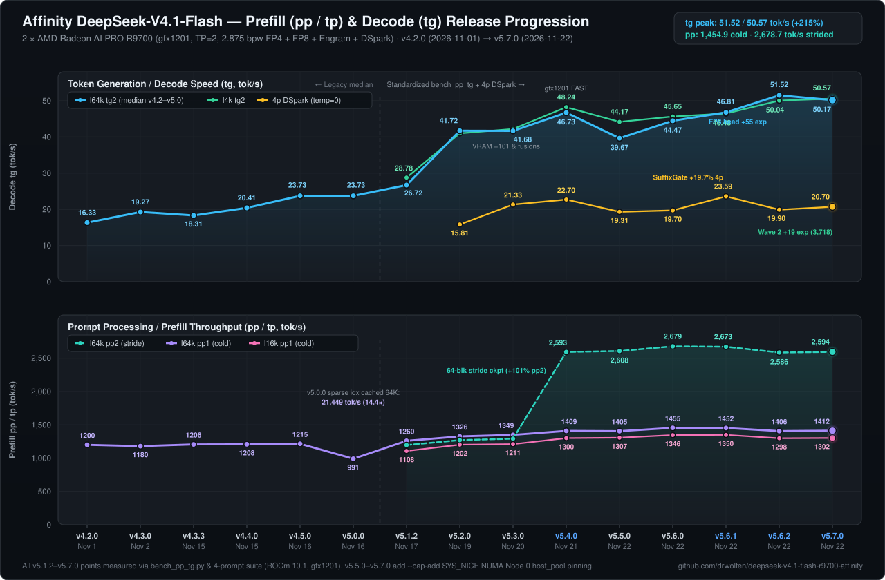

# deepseek-v4.1-flash-r9700-affinity

A production setup for serving **DeepSeek-V4.1-Flash** (uncensored / abliterated `MoonMath-1017` build) on **dual AMD Radeon AI PRO R9700 GPUs** (`gfx1201`, RDNA 4, Wave32, TP=2), built on a tuned fork of the [affinity](https://codeberg.org/StillDeadcode/affinity) inference engine paired with a locally quantized 2.875-bpw `.aff` model container.

This repository captures the full stack: engine source (RDNA 4 HIP kernels + host runtime + server), `Dockerfile` (`ROCm 10.1.0-full` default), systemd/Docker deployment manifests, quantization recipes, unit/kernel regressions, and paired benchmarks measured on dual R9700 hardware.

> **Hardware scope:** Every benchmark and profile below was measured on a two-card **Radeon AI PRO R9700** (`2 × 32 GiB`, TP=2) system. Upstream supports single-card execution, which was not benchmarked here.

---

### Model Weights & Artifacts

- **MoonMath 1017 (`.aff` + `.dspark.aff` + `.engram`):** [huggingface.co/Muoniolalusta/DeepSeek-V4.1-Flash-1017-MoonMath-aff](https://huggingface.co/Muoniolalusta/DeepSeek-V4.1-Flash-1017-MoonMath-aff)
- **1017 revision:** [huggingface.co/Muoniolalusta/DeepSeek-V4.1-Flash-1017-UNCENSORED-affinity-2.875bpw](https://huggingface.co/Muoniolalusta/DeepSeek-V4.1-Flash-1017-UNCENSORED-affinity-2.875bpw)
- **Legacy 0925 revision:** [huggingface.co/Muoniolalusta/DeepSeek-V4.1-Flash-UNCENSORED-affinity-2.875bpw](https://huggingface.co/Muoniolalusta/DeepSeek-V4.1-Flash-UNCENSORED-affinity-2.875bpw)

**Documentation & Release Links:** [**`CHANGELOG.md`**](CHANGELOG.md) | **Releases:** [**`v5.9.0`**](https://github.com/drwolfen/deepseek-v4.1-flash-r9700-affinity/releases/tag/v5.9.0) (Latest) · [**`v5.8.0`**](https://github.com/drwolfen/deepseek-v4.1-flash-r9700-affinity/releases/tag/v5.8.0) · [**`v5.7.0`**](https://github.com/drwolfen/deepseek-v4.1-flash-r9700-affinity/releases/tag/v5.7.0) · [**`v5.6.2`**](https://github.com/drwolfen/deepseek-v4.1-flash-r9700-affinity/releases/tag/v5.6.2) · [**`v5.6.1`**](https://github.com/drwolfen/deepseek-v4.1-flash-r9700-affinity/releases/tag/v5.6.1) · [**`v5.6.0`**](https://github.com/drwolfen/deepseek-v4.1-flash-r9700-affinity/releases/tag/v5.6.0) · [**`v5.5.0`**](https://github.com/drwolfen/deepseek-v4.1-flash-r9700-affinity/releases/tag/v5.5.0) · [**`v5.4.0`**](https://github.com/drwolfen/deepseek-v4.1-flash-r9700-affinity/releases/tag/v5.4.0) · [**`v5.3.0`**](https://github.com/drwolfen/deepseek-v4.1-flash-r9700-affinity/releases/tag/v5.3.0) | **Benchmark Reports:** [**`v5.9.0 gfx1201 Transfer/VRAM & code_edit`**](docs/v5.9.0-gfx1201-xfer-codeedit-benchmark.md) · [**`v5.8.0 gfx1201 Rust/ASM/Cache`**](docs/v5.8.0-gfx1201-rust-asm-cache-benchmark.md) · [**`v5.7.0 Wave 2 DSpark, FP8 & PCIe`**](docs/v5.7.0-wave2-dspark-fp8-pcie-benchmark.md) · [**`v5.6.2 DSpark Bugfix & Quick Wins`**](docs/v5.6.2-dspark-bugfix-and-quickwins-benchmark.md) · [**`v5.6.1 SuffixGate 4-Arm`**](docs/v5.6.1-suffix-gate-benchmark.md) · [**`v5.6.0 FP8 E4M3 Optimization`**](docs/v5.6.0-fp8-e4m3-benchmark.md) · [**`v5.5.0 Radiance Ports`**](docs/v5.5.0-radiance-port-benchmark.md) · [**`v5.4.0 Optimization & Engine Assessment`**](docs/v5.4.0-optimization-and-engine-assessment.md) · [**`v5.3.0 HIP Optimization`**](docs/v5.3.0-hip-kernel-optimization-benchmark.md) · [**`v5.2.0 Optimization`**](docs/benchmarks/2026-11-18-v5.2-deepseek-optimization.md) · [**`v5.1.0 & MoonMath-1017`**](docs/benchmarks/2026-11-16-v5.1-and-moonmath-1017-bakeoff.md) · [**`v5.0.0 & Radiance v2.1`**](docs/benchmarks/2026-11-15-v5.0-and-radiance-v2.1-bakeoff.md)

---

## Table of Contents

1. [Release Highlights (Waves 0–12)](#release-highlights-waves-012)
2. [Architecture, Memory Topology & Hardware Platform](#architecture-memory-topology--hardware-platform)
3. [What's New in `v5.9.0`: `gfx1201` Transfer/VRAM Reclamation & `code_edit` Recovery](#whats-new-in-v590-gfx1201-transfervram-reclamation--code_edit-recovery)
4. [What's New in `v5.8.0`: `gfx1201` Rust/HIP/AVX2 & VRAM Arena Optimization](#whats-new-in-v580-gfx1201-rusthipavx2--vram-arena-optimization)
5. [What's New in `v5.7.0`: Wave 2 DSpark, FP8 & PCIe Optimizations (`W2-1..W2-9`)](#whats-new-in-v570-wave-2-dspark-fp8--pcie-optimizations-w2-1w2-9)
6. [What's New in `v5.6.2`: DSpark Bug Fixes, Shared FP8 LM Head & Wave 10A Quick Wins](#whats-new-in-v562-dspark-bug-fixes-shared-fp8-lm-head--wave-10a-quick-wins)
7. [What's New in `v5.6.1`: Dynamic DSpark-Aware `SuffixGate`](#whats-new-in-v561-dynamic-dspark-aware-suffixgate)
8. [What's New in `v5.6.0`: Wave 9 FP8 E4M3 Native Conversions (`F1–F8`), NUMA `SYS_NICE` & Effort 75](#whats-new-in-v560-wave-9-fp8-e4m3-native-conversions-f1f8-numa-sys_nice--effort-75)
9. [What's New in `v5.5.0`: Radiance Wave 8 Ports (`R1–R7`)](#whats-new-in-v550-radiance-wave-8-ports-r1r7)
10. [What's New in `v5.4.0`: `gfx1201` Stabilization, Zero-D2H Pool & Agentic Fixes](#whats-new-in-v540-gfx1201-stabilization-zero-d2h-pool--agentic-fixes)
11. [What's New in `v5.3.0`: RDNA 4 (`gfx1201`) HIP Kernel Deep Dive](#whats-new-in-v530-rdna-4-gfx1201-hip-kernel-deep-dive)
12. [v5.3.0 3-Arm Paired Benchmark & ROCm 10.1 vs 10.2 Evaluation](#v530-3-arm-paired-benchmark--rocm-101-vs-102-evaluation)
13. [Measured Performance Progression (Waves 0–12)](#measured-performance-progression-waves-012)
14. [Wave 4 Bake-Off: `affinity` vs `StillDeadcode/radiance v2.1.0`](#wave-4-bake-off-affinity-vs-stilldeadcoderadiance-v210)
15. [Rework and Patches (`v1.0.0` → `v5.9.0`)](#rework-and-patches-v100--v590)
16. [Production Safety Invariants & Environment Variable Reference](#production-safety-invariants--environment-variable-reference)
17. [Build, Test, Deploy & Rollback Guide](#build-test-deploy--rollback-guide)
18. [Credits](#credits)

---

## Release Highlights (Waves 0–12)

- **[`v5.9.0`](https://github.com/drwolfen/deepseek-v4.1-flash-r9700-affinity/releases/tag/v5.9.0)** (`e41f0c5`): Wave 12 audits all PCIe Gen3 ×16, peer barriers, GDDR6, and L0/L1/L2/MALL/LDS data transfers (confirming `model-moonmath-1017.aff` entropy `7.996 bits/byte` / `0.41%` zeros makes wire compression negative-EV vs zero-copy UVA while VRAM reclamation cuts PCIe transfers directly), shrinks dense/draft/prefill/indexer VRAM by **`~518–520 MiB/card`** (`dense` `-144`, `draft dense` `-38`, `prefill arena` `908 -> 654`, `compressor+indexer` `218 -> 112`) to expand live GPU-resident MoE slots by **`+121` (`3,813 -> 3,934`: `3,864` shared `25.2%` + `70` Card-1 bonus `425.5 MiB`)** at `[355, 356]` MiB free VRAM (`[339, 332]` post-smoke), reverses the `v5.8.0` `code_edit` regression (**`46.43 tok/s` `tg2`**, `+3.06%` vs `v5.8.0` `45.05`, `+1.95%` vs `v5.7.0` `45.54`, **`95.1%` acc / `10.24 tok/blk` / `25` blk**), lifts **`step_c` to `23.16 tok/s` (`+3.30%`)**, **`l16k tg1` (`+9.18%`)**, **`p4k tg2` (`+5.63%`)**, and hits a new **`l64k pp2` record at `2,716.2 tok/s` (`+2.11%`)**. Empirical Wave 5b 4-arm ablation locks `{AFF_GFX12_CACHE_HINTS, AFF_FP8_GEMM_V2, AFF_EXPERT_DECODE_V2, AFF_TP_AR_FIXED_TOK}` opt-in OFF (`=0`) and caps `sfx_burst_max` at `sfx_max` (`12`). Passes `ldd` (`0` missing), **`33/33` `-ffp-contract=off`**, **`11/11` CPU `ctest` (`0.48 s`, `test_suffix_draft 17/17`)**, **`29,585` audited ELF kernels (`0` new scratch/VGPR spill, `0` flash2 violations)**, **`5/5` default + `3/3` OFF GPU suites**, `DRY 3/3`, `probe_bug567`, `N0=100%`, `3.548 s` KFD release, `pcache fp=0x733de762fee543e6`, and live `:8000` smoke `'391'`. See [`docs/v5.9.0-gfx1201-xfer-codeedit-benchmark.md`](docs/v5.9.0-gfx1201-xfer-codeedit-benchmark.md).

- **[`v5.8.0`](https://github.com/drwolfen/deepseek-v4.1-flash-r9700-affinity/releases/tag/v5.8.0)** (`ecfb36d`): Wave 11 combines GPU VRAM arena and gather-only indexer compaction, AMDGCN pure-LDS/DPP16 primitives, Rust static-library acceleration (`libaff_rust_accel.a`), Skylake-SP AVX2/C++20 host paths, and empirical `gfx1201` L2/MALL cache tuning (`b071d49`..`ecfb36d`): shrinks `prefill arena` (`1,100 -> 908 MiB/card`) and `compressor + indexer` (`442 -> 218 MiB/card`) to expand live GPU-resident MoE capacity by **`+95` (`3,718 -> 3,813`: `3,723` shared + `90` Card-1 bonus `547.1 MiB`)** at `[356, 357]` MiB free VRAM (`[347, 340]` post-smoke), and hits new decode records across every depth: **`56.25 tok/s` `l64k tg2` (`+12.12%` vs `v5.7.0`)**, **`54.94 tok/s` `l4k tg2` (`+8.64%`)**, **`52.77 tok/s` `l16k tg2` (`+19.09%`)**, **`1,440.2 / 2,660.0 tok/s` `l64k pp1/pp2` (`+1.98% / +2.53%`)**, and **`22.42 tok/s` / `138.70 ms/blk` `step_c` (`+8.31%`)**. Empirical ablation keeps `AFF_DENSE_NT_LOAD=0` (preserving `gfx1201` 64 MiB MALL + 8 MiB L2 reuse) and `AFF_BONUS_D2D=0` (pinning Card-1 bonus shards statically) opt-in OFF. Passes `ldd` (`0` missing), **`33/33` `-ffp-contract=off`**, **`11/11` CPU `ctest` (`0.50 s`)**, **`4,021` AMDGPU ELF kernels (`1,009` in `affinity`, `0` scratch / `0` VGPR spill)**, **`5/5` default + `3/3` OFF + `2/2` opt-in `=1` GPU suites**, `DRY 3/3`, `probe_bug567` `all_pass=true`, `N0=100%`, `0` `hipError`, `3.386 s` KFD release, and live `:8000` smoke `'391'`. See [`docs/v5.8.0-gfx1201-rust-asm-cache-benchmark.md`](docs/v5.8.0-gfx1201-rust-asm-cache-benchmark.md).

- **[`v5.7.0`](https://github.com/drwolfen/deepseek-v4.1-flash-r9700-affinity/releases/tag/v5.7.0)** (`b223f20`): Wave 10B / Wave 2 optimizes DSpark Markov weights/communication, batched FP8 LM-head dispatch, PCIe activation rings, MoE launches, and Flash `Q` staging (`W2-1..W2-9`): maps `mtp_markov_w1` via UVA host RAM (`63.1 MiB`, `0` VRAM/card), row-splits `mtp_markov_w2` as group-128 FP8 (`16.0 MiB/shard` vs `31.6 MiB`), adds P2P spin-reduce (`W2-3`), raises `AFF_LMHEAD_FP8_MAX_T=16` (`W2-4`), outputs BF16 directly into `head_sample` (`W2-6`), compacts `ActRing` with device `act_dev_head_` (`W2-7`), fuses MoE gate+up `grid.z` launches + narrow RMSNorm (`W2-8`), and stages E4M3 `Q` into `flash_kernel` (`W2-9`, cutting `flash_kernel<2>` to `230` VGPRs @ `occ=6`), while locking `W2-5` (`AFF_AR_HC_BF16=0`) opt-in after Phase 2/2B ablation proved target-layer BF16 wire rounding hurt speculation (`req00 0/3`, `step_c 168.52 -> 144.09 ms/blk`). Grows live GPU-resident MoE capacity by **`+19` (`3,699 -> 3,718`)** at `[355, 352]` MiB free VRAM (`362 / 356 MiB` draft dense weights), sets new peaks on **`code_edit` (`45.54 tok/s` `tg2`, `+6.18%` vs paired `v5.6.2`)** and **`l4k` (`50.57 tok/s` clean / `53.79` Phase 2B)**, and improves `l64k` (`1,412.3` `pp1` / `2,594.3` `pp2` / `50.17` `tg2`) and `step_c` (`148.78 ms/blk` clean, `22.13 tok/s` / `144.09 ms/blk` Phase 2B). Passes `ldd` (`0` missing), **`33/33` `-ffp-contract=off`**, **`12/12` offline CPU `ctest`**, **`706` / `705` / `701` AMDGPU ELF kernels (`0` scratch / `0` VGPR spill)**, **`5/5` GPU suites** (Tests 29–31, 15–18) + `2/2` RC1 fallback-OFF, `DRY 3/3`, `probe_bug567` `all_pass=true`, `N0=100%`, `0` `hipError`, `3.565 s` KFD release, and live `:8000` smoke `'391'`. See [`docs/v5.7.0-wave2-dspark-fp8-pcie-benchmark.md`](docs/v5.7.0-wave2-dspark-fp8-pcie-benchmark.md).

- **[`v5.6.2`](https://github.com/drwolfen/deepseek-v4.1-flash-r9700-affinity/releases/tag/v5.6.2)** (`1676e05`): Wave 10A fixes multi-`n_expert` router bias stride collision (`BUG-1`: `D.b_rbias` no longer overwritten in target L13/L14 by DSpark `n_expert=128`), draft router `mmap` over-read + per-call banding (`BUG-2`), `~DenseGpu()` interior-pointer / `hipHostFree` teardown bugs, dynamic per-block repeat penalty (`BUG-5`: `AFF_REPEAT_PENALTY_DYNAMIC=1`), think-scoped DRY prompt protection (`BUG-6`), and short-scale mantra/novelty `ThinkingBudget` breakers (`BUG-7`: `short_loop` + `short_low_novelty`), while shipping five quick wins: `C4` shared FP8 group-128 LM head (removes `-e AFF_DRAFT_HEAD_INT4=1` from deploy manifests), `C1` `AFF_ROUTER_RANK0_ONLY=1`, `A1` `AFF_AR_FIXED_BLK=32`, `B4` 2-wide `e4m3_decode_pk` + `AFF_DRAFT_ATTN_NHB=2`, and `D1` `AFF_ADAPTIVE_COST_RESCALE=1` (`PCIe #5` / `StageRing::fit` hysteresis withheld after `-2%..-4.6%` prefill/decode checks). Expands live GPU-resident MoE slots by **`+55` (`3,644 -> 3,699`)** at `[354, 354]` MiB free VRAM and reaches **`50.04 tok/s` `l4k tg2`** (`+7.7%` vs `v5.6.1`), **`49.75 tok/s` `l16k tg2`** (`+7.0%`), **`51.52 tok/s` `l64k tg2`** (**`+10.1%`**, `47.79` cold `tg1`, `1,405.8` `pp1` / `2,585.5` `pp2`), **`21.24 tok/s` `p4k tg2`** (`+16.5%`), **`43.75 tok/s` `code_edit tg2`**, and `19.90` clean / `23.48` ablation `step_c`. Passes **`11/11` CPU `ctest`**, **`5/5` GPU suites** (Tests 26–28), **`33/33` `-ffp-contract=off`**, **`673` ELF kernels (`0` scratch / `0` VGPR spill)**, **`9/9` `mqa_attend*` `v_cvt_pk_f32_fp8`**, `N0=100%`, `DRY 3/3`, `BUG-5/6/7` live probes, cross-version `pcache` (`0x733de762fee543e6`), `0` `hipError`, and `3.387 s` KFD release. See [`docs/v5.6.2-dspark-bugfix-and-quickwins-benchmark.md`](docs/v5.6.2-dspark-bugfix-and-quickwins-benchmark.md).

- **[`v5.6.1`](https://github.com/drwolfen/deepseek-v4.1-flash-r9700-affinity/releases/tag/v5.6.1)** (`3f29dbf`, `cfcbb18`): Wave 9.1 adds dynamic DSpark-aware **`SuffixGate`** (`AFF_DRAFT_SUFFIX_DYNAMIC=1`, `AFF_DRAFT_SUFFIX_GAIN=1.05`) in [`src/engine/suffix_draft.h`](src/engine/suffix_draft.h) and [`tools/affinity.cpp`](tools/affinity.cpp), comparing effective suffix utility `(1 + expect * acc_ema) / cost_ema[prop_nd + 1]` against live GPU DSpark, requiring `>= min_match + 2` exact anchor tokens to enter suffix mode (`>= min_match + 1` inside proven streaks), and applying exponential miss cooldown (`2, 4, 8, 16`) when acceptance drops below `max(2, nd/2)`. In 4-arm cold-start NUMA benchmarks (`--default-effort 60`), `v5.6.1` recovers full pure-DSpark reasoning speed (**`23.59 tok/s`** 4-prompt mean, **`3.605 tok/blk`**, **`+19.7%`** vs `v5.6.0`, **`+3.9%`** vs `v5.4.0` FAST) while keeping **`43.51 tok/s` `code_edit`** (`99.6%` acc, **`8.00 tok/blk`**, `+9.8%` vs pure DSpark) and reaching **`46.81 tok/s` `l64k tg2`** (`99.8 ms/blk`) and **`18.23 tok/s` `p4k tg2`**. Preserves **`3,644` resident experts**, **`673` `gfx1201` kernels (`0` scratch / `0` VGPR spill)**, `-ffp-contract=off`, `10/10` `test_suffix_draft` + `11/11` CPU `ctest`, `N0=100%`, and `pcache` `0x733de762fee543e6`. See [`docs/v5.6.1-suffix-gate-benchmark.md`](docs/v5.6.1-suffix-gate-benchmark.md).

- **[`v5.6.0`](https://github.com/drwolfen/deepseek-v4.1-flash-r9700-affinity/releases/tag/v5.6.0)** (`6383b19..1807d6b`): Wave 9 converts remaining hot dense, Engram, attention-output, all-reduce, and target LM head stages onto native `gfx1201` hardware FP8 E4M3 (`F1–F8`), enables NUMA Node 0 `host_pool` page pinning via `--cap-add SYS_NICE` (`47,804,160 / 47,804,160` = `100.0%` on Node 0; `Engram` spills safely to Node 1 at `0.00 pgscank/s`), and sets `--default-effort 75` in deploy manifests: `idx_wq_b` FP8 (`F1`: `AFF_IDX_WQB_FP8=1`), grouped `attn_out_a` direct FP8 (`F2`: `AFF_ATTN_OUT_A_FP8=1`, `b_attn_out` **`-25.2%`**), `mtp_main_proj` FP8 (`F3`: `AFF_MTP_PROJ_FP8=1`), packed TP=2 E4M3 all-reduce (`F4`), raw MXFP8 Engram H2D + on-GPU requant (`F5`: `AFF_ENGRAM_RAW_H2D=1`, `11` VGPRs / `16` occ), group-128 E4M3 target LM head (`F6`: `AFF_LMHEAD_FP8=1` default ON, `320.6 MiB/shard`, `b_mv_host` **`-36.9%`** / host wait **`-86%`**, **`3,644` resident experts**, `+27` vs `v5.5.0`, `+51` vs `v5.4.0`), hardware `e4m3_enc` + `[7.5*2^-9, 8*2^-9)` subnormal carry fix (`F7`), and 2-wide norm-quant + uniform `AFF_O_FP8_QDQ=1` (`F8`). Paired cold-start NUMA-local benchmarks improve `p4k tg2` **`+5.1%`** (`17.21`), `l4k` **`+4.1% pp1` / `+6.8% tg1` / `+3.4% tg2`** (`45.65`), `l16k` **`+3.0% pp1` / `+8.1% tg1` / `+8.4% tg2`** (`43.81`), `l64k` **`+3.6% pp1` / `+2.7% pp2` / `+12.1% tg2`** (`44.47`), `code_edit tg2` **`+3.7%`** (`41.50`), `step_c` 4-prompt DSpark **`+2.0%`** (`19.70`), and `step_d turn4_100k_cached` **`+16.7%`** (`22.74`, `0.914 s` TTFT). Verified **`673` `gfx1201` kernels (`0` scratch, `0` VGPR spill)**, **`15/15` `aff_gpu` & `27/27` `aff_format` `-ffp-contract=off`**, **`16/16` full `ctest` (`11/11` CPU + `5/5` GPU)**, F3/F5/F6/F7 gates, cross-version `pcache` restore (`0x733de762fee543e6`), `--default-effort 75` smoke (`req00=0.43 s`, `25.43 tok/s` math, `16.40 tok/s` tool call, `0` aborts), and `3.105–3.400 s` KFD release. See [`docs/v5.6.0-fp8-e4m3-benchmark.md`](docs/v5.6.0-fp8-e4m3-benchmark.md).

- **[`v5.5.0`](https://github.com/drwolfen/deepseek-v4.1-flash-r9700-affinity/releases/tag/v5.5.0)** (`e9279b1..55de363`): Ports seven Radiance Wave 8 optimizations (`R1–R7`) onto `v5.4.0` while keeping target numerics bit-exact (`-ffp-contract=off`, prefix-cache fingerprint `0x733de762fee543e6` preserved): pure-LDS `lds_barrier()` + `s_wait_storecnt`/agent fences (`R1`), register-buffered `RegForm` + early wake store AR (`R3`: `AFF_AR_REG_FORM=1`, `AFF_AR_WAKE_STORE=1`), pre-collapsed AR+V4.1 RMSNorm fusion (`R4`: `AFF_FUSE_AR_RMSNORM=1`), lossless 12.25-bit `bf16x12` target LM head (`R5`: `AFF_LMHEAD_BF16X12=1`, **`3,617` resident experts**, `+24` vs `v5.4.0`), CPU incremental `SuffixDraftIndex` speculative drafter ahead of DSpark (`R6`: `AFF_DRAFT_SUFFIX=1`, `AFF_DRAFT_DEPTH_STOP=1`), and evidence-locked opt-in flags `AFF_TP_AR_CODED=0` (`R2`: `-54.8%` KL vs FP32 at `~2.5%` 64K PP cost) and `AFF_PREFETCH_BESIDE=0` (`R7`: `-15.5%..-33.2%`). Stage B2 paired benchmarks achieve **43.16 tok/s (`+25.5%`)** @ `l4k`, **44.55 tok/s (`+31.9%`)** @ `l16k`, **43.70 tok/s (`+36.2%`)** @ `l64k`, **40.27 tok/s (`+43.1%`)** @ `code_edit`, **`+0.4%` to `+15.3%`** 4-prompt DSpark, and **`+45.9%` `turn3` / `+43.6%` `turn4`** on `80K -> 123K` multi-turn. Verified **`599` `gfx1201` kernels (`0` scratch, `0` VGPR spill)**, **`11/11` CPU `ctest` + `5/5` GPU + fallback-OFF + `64/64` static-placement parity PASS**, `DRY 3/3`, `</think>` `653/653` restored, `64`-block stride verified at `64K`/`80K`, and `3.298 s` KFD release. See [`docs/v5.5.0-radiance-port-benchmark.md`](docs/v5.5.0-radiance-port-benchmark.md).

- **[`v5.4.0`](https://github.com/drwolfen/deepseek-v4.1-flash-r9700-affinity/releases/tag/v5.4.0)** (`9f44992..b2ab8d3`): Stabilizes RDNA 4 (`gfx1201`) decode by eliminating the `~17–26 us` per-kernel ROCm/TheRock `#9297` & multi-SE CWSR stall (`GPU_MAX_HW_QUEUES=1` + single-SE 25% contiguous CU mask `0x000000ff`, `8/32 WGPs`, `10` KFD queues vs `16`; `6/6 = 100%` FAST mode), enables zero-D2H immutable full NUMA-0 host pooling (`AFF_POOL_FULL=1`, `0.00 GiB` D2H, **`3,563` resident experts**), upgrades MoE/dense/indexer/TP2/Engram kernels, adds async batched prefix-cache I/O, chunk-aligned `64`-block stride (`33,792` tok) and `</think>` checkpoints, and hardens DRY (`AFF_DRY_GEN_ONLY=1`, `AFF_DRY_RESET_ON_THINK_CLOSE=1`, `dry_min_repeats=4`, prompt-verbatim protection). Paired benchmarks reach **45.81–48.24 tok/s** warm decode (`+6.16%` to `+10.13%` over FAST `v5.3.0`), **`1,409.0 tok/s` (`45.3 s`)** cold `@64K` prefill (`+4.27%`), **`22.70 tok/s`** 4-prompt DSpark (`+9.08%` vs FAST `v5.3.0`, `+15.17%` vs paired `v5.3.0`), **`14/14` CPU `ctest` + `5/5` GPU + `3/3` functional + `3/3` DRY repeats PASS** (`0` `hipError`, `0` new ELF spills). Engine bake-off confirms Affinity `v5.4.0` remains faster and higher precision (`2.875 bpw`) than `mw00/project-maya v1.1.70` (`34.0 / 444 tok/s` @ `1.63 bpw`). See [`docs/v5.4.0-optimization-and-engine-assessment.md`](docs/v5.4.0-optimization-and-engine-assessment.md).

- **[`v5.3.0`](https://github.com/drwolfen/deepseek-v4.1-flash-r9700-affinity/releases/tag/v5.3.0)** (`dfb34cb`, `c20ed32`, `e1f6be3`, `d64eea9`): RDNA 4 (`gfx1201`, Wave32) HIP kernel optimizations across Wave A (`lds_barrier()`, DPP16 `dpp_xor_lane<Lane>()`, `AFF_WAVES(n)`, `safe_grid_blocks()`, vectorized HC all-reduce, async `MoePlanStatus` readback, packed token-major routing/logits) and Wave B (`AFF_FP8_PREFILL_4X2`, `AFF_FP8_SPLIT_INLINE`, `AFF_TP_AR_STAGED`, `AFF_FLASH_MIN_TILES`, `flash_kernel<2>` `occ=6` register/LDS tightening, `idx_quant_kernel` spill elimination, contiguous multi-GEMM output band + WGP `agent` acquire fence fix). Paired 3-arm benchmark on ROCm `10.1.0-full` (winning over ROCm `10.2.0-full` by **`+3.55%`** composite) reaches **41.47–42.23 tok/s** decode at 16K–64K (**`+24.9%` to `+43.8%` `tg`** over `v5.2.0`), **`+37.05%`** slot `blocks/s` (`5.586 -> 7.656`), **`21.33 tok/s`** 4-prompt DSpark mean (`+34.9%`), **`-34.0%`** `dense-gpu` device time, **`-23.0%` / `-23.7%`** `routed-expert` device time, and **`-85.2%`** `x_gu + x_down` at **`3,517`** resident experts (`[353, 355] MiB` idle free VRAM, `2.800 s` KFD release). Verified **13/13 filtered CPU `ctest` + 5/5 GPU binaries (ROCm 10.1 & 10.2) + 2/2 fallback-toggle runs PASS** (`0` `hipError`, `0` new ELF spills). See [`docs/v5.3.0-hip-kernel-optimization-benchmark.md`](docs/v5.3.0-hip-kernel-optimization-benchmark.md).
- **v5.2.0** (`44e81ee`): Reclaimed dead V4.1 Q-RMS/compressor VRAM and tiled Engram H2D/gather (`-616 MiB/card`), expanding GPU-resident MoE capacity by **+101 experts (`3,416 -> 3,517`)** at `[355, 354] MiB` free VRAM (`0` OOM/`0` spill). Fused `attn_out` prep (`AFF_FUSED_ATTN_OUT_PREP`), specialized `kFKNarrow=128` FP8 multi-GEMM (`AFF_FP8_NARROW128`), reused norm Q8 (`AFF_REUSE_NORM_Q8`), skipped decode Engram threadpool overhead (`live < 64`), and synchronized prefill before decode -> **41.00–41.72 tok/s** warm Pass-2 decode (`+30.2%` to `+56.1%` over `v5.1.2`), **`+6.8%` to `+42.0%`** cold Pass-1 decode (`21.33–38.74 tok/s`), **`+5.2%` to `+12.6%`** prefill, **`+14.4%` to `+17.3%`** 4-prompt `temp=0` DSpark decode, and **`-47.0%` / `-55.9%`** cached multi-turn TTFT (`64K -> 100K`). Hardened OpenAI SSE serving with `fd_alive` disconnect probing (`<=1.13 s` FIFO drop, `0` wasted tokens), 15 s empty-delta SSE keepalives, `PrefillAlive` abort hook, O(1) tokenizer decode + BPE/LCP caching, and hardened delta prefix-cache lookup. **4/4 GPU kernel suites + 9/9 CPU `ctest` suites PASS**. See [`docs/benchmarks/2026-11-18-v5.2-deepseek-optimization.md`](docs/benchmarks/2026-11-18-v5.2-deepseek-optimization.md).
- **v5.1.2** (`c52e95e`): Ported Lucebox `ThinkingBudget` (default `--thinking-reply-reserve 4096` / `AFF_THINK_REPLY_RESERVE`, `--thinking-loop-repeats 3` / `AFF_THINK_LOOP_REPEATS` over `loop_span=64`), added the Executive-Freeze Churn Breaker (`--thinking-freeze-breaker 1` / `AFF_THINK_FREEZE_BREAKER`, triggers `force_close` after 512 thinking tokens when trailing 256 tokens contain >=64 newline-group tokens and <=36 distinct IDs), synchronized `spec_decode` DSpark seeding/rollback across forced `</think>` injection (`\n</think>\n\n`), and added cache-preserving `reasoning_effort: "none"` (`"off"`/`"0"`) override (`suppress_final_think`) that preserves `idx == 0` effort prompts and historical `<think>...</think>` byte-identical across all `n_pre` tokens while closing only the final `<think>` (`128821` -> `128822`). 7/7 CPU unit tests PASS.
- **v5.1.1** (`63cd104`): Hotfix for multi-region/multi-rank (`TP=2`) delta prefix-cache restore offsets (`PrefixCache::restore()` indexes `impl_->rbuf[0]` via the full `B`-token `region_span` layout and per-rank stride across heterogeneous `app_` regions; on-disk `pcache` remains intact without wiping) and strict UTF-8 streaming holdback (`utf8_safe_end`), EOS/final-flush sanitization (`sanitize_utf8`), and validating `json_escape` (`U+FFFD` replacement for truncated/malformed sequences). 6/6 CPU unit tests PASS.
- **v5.1.0** (`839665f`): DSpark ring-attention tile skip (`AFF_DRAFT_SKIP_MASKED=1`, **+22.2%** decode speedup: 16.93 -> 20.69 tok/s), paired `temp=0` DSpark acceptance **`73.33%`** on `MoonMath-1017` (vs 67.52% on v5.0.0, **+5.81 pp**; **80.0%** on code, **+9.0%** paired mean gen), compact state-only delta prefix cache (`AFF_PCACHE_DELTA=1`, 1.42× multi-turn TTFT speedup), `ignore_eos=true` raw streaming, GPU `gridDim.y > 65535` overflow guard (#1006), DSML nested XML tool-argument protection and multi-call invoke splitting (#1020), and MoE stream RAW barrier validation (#983, #984). Retained `AFF_ATTN_LOOKAHEAD=0` default (-11.4% regression when enabled). 6/6 CPU unit tests PASS.
- **v5.0.0** (`264e8d5`): RDNA 4 `gfx1201` sparse indexer (`AFF_SPARSE_INDEXER=1`, `index_topk=512`), `K_VECS_PADDED=136` + 8B Q staging, 4-pass 256-bucket radix top-512, Wave32 tie compaction, live-`seqused` ragged causal prefill, 36 MiB score scratch budget -> **3,416 resident experts (+49)**, **14.40× @64K** & **13.15× @128K** prefix-reused prefill, Needle **4/4 (100%)**, `refattn.py` **99.98%** parity, `quant_eval` **92.5%** (111/120), 9/9 tests PASS.
- **v4.5.0** (`9ec7c47`): Fused & chained hybrid compute (`AFF_HC_FUSED_V2=1`, `AFF_HC_CHAINED=1`, `AFF_HC_CHAINED_MIN_ROWS=1`) -> **`23.73 tok/s` decode median (`24.37` peak)**, **`22.4 tok/s` batch-8 aggregate**, `0.000000 nats` 8,184-tok KL (`PPL 2.6057`), `90.83%` `quant_eval`, 8/8 tests PASS.
- **v4.4.0** (`718b42e`): Upgrade to ROCm 10.1 (`20.41 vs 18.49 tok/s`, **+10.4%**), `AFF_CACTUS_ESCAPE=0.25` (**`0/20` repetition lock-in** @ `temp=0.6`), 64 GiB persistent prefix cache, Issue #12 `heat -> static` fallback, cross-shard `.scale` fix, DSML typed-arg parity.
- **v4.3.3** (`5275c64`): Unified 3-way branch history; `GET /health`, `--raw-completions`, `cached_tokens` reporting; 7/7 tests PASS.
- **Wave 4 Radiance v2.1.0 Bake-Off**: Offline ROCm 10.1 evaluation confirmed upstream open-source Radiance omits the `deepseek41` plugin, MLA/Engram kernels, and `F8_E8M0` scales.

---

## Architecture, Memory Topology & Hardware Platform

### Reference Machine

| Component | Specification |
|---|---|
| GPUs | **2 × AMD Radeon AI PRO R9700**, `gfx1201` (RDNA 4, Wave32, TP=2), 32 GiB VRAM each (`32,624 MiB` total reported/card) |
| CPU | **2 × Intel Xeon Platinum 8160** (Skylake-SP), 48 cores / 96 threads total (`--cpuset-cpus=0-23,48-71` pinned for serving) |
| Host RAM | **754 GiB DDR4** across 2 NUMA nodes |
| PCIe Interconnect | GPUs negotiate **Gen5 ×16**, switched host/peer uplink runs at **Gen3 ×16 (8.0 GT/s)** |
| Host OS | **Ubuntu 24.04.5 LTS** (Noble Numbat), kernel 7.0 |
| Container Base | **ROCm `10.1.0-full`** (`docker.io/rocm/dev-ubuntu-24.04:10.1.0-full`, `gfx1201`) |
| Image Tag | `deepseek-affinity:v5.9.0` |
| Serving Topology | OpenAI-compatible HTTP/SSE container on `:8000` (with optional local reverse proxy on `:8080`) |

### DeepSeek-V4.1-Flash Memory & Placement Architecture

DeepSeek-V4.1-Flash uses 40 layers, 384 routed experts (top-6 active per token), `hidden_size = 5120`, and `vocab_size = 129,280`. At 2.875 bpw the routed experts total ~93 GiB and the full quantized container is **191.32 GiB** — exceeding 64 GiB aggregate VRAM, so Affinity splits weights across GPU HBM/GDDR, 2 MiB transparent hugepages in host RAM, mmap'd NVMe tables, and GPU caches:

| Subsystem | Placement / Backing | Measured Footprint (`v5.9.0` Live Ledger) |
|---|---|---|
| **Dense Weights** | TP=2 sharded across both GPUs (`AFF_ROUTER_RANK0_ONLY=1` rank-0 routers; `AFF_ENGRAM_TP_SHARD=1` row-sharded `engram_wkv`; shared group-128 FP8 E4M3 LM head `320.6 MiB/shard`) | **`4,254 / 4,094 MiB`** GPU0/GPU1 (**`-144 MiB/card`** vs `v5.8.0`), `110 MiB` runtime |
| **Routed MoE Experts (GPU)** | 2-way shards (`6.08 MiB/shard`), demand placement with `32` shadow slots (`0.00 GiB` D2H); card-1 asymmetric bonus slab (`70` shards / `425.5 MiB`, `AFF_BONUS_D2D=0` static pin) | **`3,934` live resident slots** (`23,684 / 24,110 MiB` GPU0/GPU1 slabs, **`+121`** vs `v5.8.0`) |
| **Routed MoE Experts (Host Pool)** | Immutable zero-D2H 2 MiB THP host pool (`AFF_POOL_FULL=1`, `--cap-add SYS_NICE` -> `MPOL_PREFERRED` Node 0), PCIe DMA read-in-place (`8/32 WGPs` contiguous SE0 `0x000000ff`) | **`15,360` experts pinned in `182.36 GiB` RAM** (`47,804,160 / 47,804,160` = `100.0%` Node 0, `0` on SSD tier) |
| **DSpark Speculative Drafter** | 3 blocks, block width 5, taps `[37, 38, 39]`, `384/384` draft experts resident; `mtp_main_proj` col-sharded (`AFF_MTP_PROJ_TP_SHARD=1`), `mtp_markov_w1` UVA host (`63.1 MiB`), `mtp_markov_w2` `fp8_g128` | **`324 / 318 MiB`** dense (`-38 MiB/card`) + `2,336 MiB` draft expert slab + `2 MiB/card` arena |
| **KV Cache & Prefill Arena** | Virtual span `327,680` positions reserved / `262,144` backed; `v2` dense/MoE cross-aliasing (`AFF_HC_INPLACE=1`, `AFF_DENSE_ARENA_ALIAS_V2=1`, `AFF_MOE_CROSS_ALIAS=1`) + `VirtualSpan` indexer (`AFF_IDX_VMEM=1`) | `344 / 346 MiB` KV (`0.67 GiB`) + **`654 / 654 MiB`** prefill (**`-254 MiB`**) + **`112 / 112 MiB`** comp/idx (**`-106 MiB`**) |
| **Engram Tables & ViT** | `32`-layer BF16 DeepSeek ViT on CPU; `188.8 GiB` Engram n-gram tables host-mmapped (`AFF_ENGRAM_WARM=1`, spills safely to Node 1 at `0.00 pgscank/s`, AVX2 decode overlap) | Host page cache mmap |
| **Persistent Prefix Cache** | Multi-slot NVMe state-only delta checkpoints (`AFF_PCACHE_DELTA=1`, parallel block restore `AFF_PCACHE_PAR_RESTORE=1`) | `64.0 GiB` configured (`512`-tok blocks, `60,505` block slots, `1,793` checkpoint slots) |
| **Total Card & Host Totals** | `[355, 356] MiB` free VRAM at load (`[339, 332] MiB` post-smoke, `gpu_headroom_mib=384`) | **`31,974 / 32,236 MiB`** in use (`32,624 MiB/card`) · **`182.36 GiB`** immutable THP host pool |

> **Residency progression (`v5.4.0 -> v5.9.0`):** `v5.4.0` held `3,563` clean (`3,593` live) experts. `v5.5.0` `bf16x12` target LM head reached `3,617` (`+24`). `v5.6.0` group-128 E4M3 LM head reached `3,644` (`+27`). `v5.6.2` shared FP8 LM head + rank-0 routers reached `3,699` (`+55`). `v5.7.0` `mtp_markov_w1` UVA + `w2` FP8 reached `3,718` (`+19`). `v5.8.0` prefill/indexer aliasing reached `3,813` (`+95`). **`v5.9.0`** adds `v2` dense/MoE arena cross-aliasing, `VirtualSpan` lazy indexer E4M3 commits, and TP-sharded `engram_wkv` / `mtp_main_proj` (`~518–520 MiB/card`), expanding GPU-resident capacity to **`3,934` live experts** (**`+121`** vs `v5.8.0`, **`+341`** vs `v5.4.0` live).

### Minimum RAM Floor

- **~200 GiB RAM** (`--host-pool-mib 200000`) is recommended for the default zero-D2H `AFF_POOL_FULL=1` full immutable pool (`182.4 GiB` pinned for all `15,360` experts + OS headroom). Hosts with tighter RAM can set `AFF_POOL_FULL=0` (~`160 GiB` floor, pinning only non-resident experts at `140–143 GiB`).
- Below that threshold, demand-paged experts spill to the SSD staging tier (4 slots / `48.6 MiB`) and generation collapses toward SSD read latency (~8 tok/s instead of ~22–51 tok/s).

---

## What's New in `v5.9.0`: `gfx1201` Transfer/VRAM Reclamation & `code_edit` Recovery

`v5.9.0` (`e41f0c5`, Wave 12) audits all PCIe, peer-P2P, GDDR6, and `gfx1201` cache/LDS transfer paths (`f0ef744`..`e41f0c5`) while preserving `-ffp-contract=off` (`33/33`), `29,585` audited AMDGPU ELF kernels (`0` new scratch / `0` VGPR spill, `0` flash2 budget violations), and `pcache` fingerprint `0x733de762fee543e6`. See [`docs/v5.9.0-gfx1201-xfer-codeedit-benchmark.md`](docs/v5.9.0-gfx1201-xfer-codeedit-benchmark.md) for the compression audit, 4-arm ablation matrix, and complete VRAM/benchmark tables.

- **Data Transfer & Compression Audit (Why VRAM Reclamation Beats PCIe Compression)**:
  - `model-moonmath-1017.aff` weights exhibit `7.996 bits/byte` entropy, `0.41%` zeros, `0 B` padding, and `zlib -1` ratio `1.0003`. Lossless compression over PCIe Gen3 ×16 cannot beat zero-copy UVA reads; growing resident GPU MoE capacity (`+121` experts to **`3,934`**) directly removes PCIe transfers.
- **`code_edit` `SuffixGate` v2 & Burst Cap Fix (`45.05 -> 46.43 tok/s`, `+3.06%` vs `v5.8.0`, `+1.95%` vs `v5.7.0`)**:
  - `AFF_SUFFIX_GATE_V2=1` (`src/engine/suffix_draft.h`, `tools/affinity.cpp`) adds `last_rejected` edit-boundary backoff, `proven_verbatim_relock` streak recovery, async `launch_suffix_acquire` overlapping prefill, and `-20 ms` DSpark bypass credit, while Wave 5b ablation caps default `sfx_burst_max` at `sfx_max` (`12`) rather than `15` to lift acceptance from `93.7%` (`32` blk) to **`95.1%` (`25` blk, `10.24 tok/blk`)**.
- **Wave 2 VRAM Reclamation, `VirtualSpan` Indexer & TP=2 Sharding (`~518–520 MiB/card`, `+121` Experts -> `3,934`)**:
  - `AFF_HC_INPLACE=1`, `AFF_DENSE_ARENA_ALIAS_V2=1`, `AFF_SKIP_SINGLE_ARENA=1`, `AFF_MOE_CROSS_ALIAS=1`, `AFF_MOE_PLAN_FAST=1`, `AFF_IDX_COMPACT_ALLOC=1`, `AFF_IDX_VMEM=1`, `AFF_ENGRAM_TP_SHARD=1`, and `AFF_MTP_PROJ_TP_SHARD=1` reclaim `144 MiB/card` dense, `38 MiB/card` draft dense, `254/256 MiB/card` prefill arena, and `106 MiB/card` compressor+indexer at `[355, 356]` MiB free VRAM (`4219d19`, `f5c0c8f` close `b_qr_cap_`, `d==0u` `tm_direct`, and final-tile `ev_eng_done` peer waits).
- **Wave 3/4 Fusions & Opt-In OFF Guardrails (`AFF_MARKOV_PERSIST=1`, `AFF_FLASH_4WAVE_RESOLVE=1`, `AFF_FUSE_BATCH_KV_NORM_PREFILL=1`, `AFF_PREFILL_FUSE_HC_Q8=1`, `AFF_PREFILL_FUSE_AR_HC=1`)**:
  - Boosts **`step_c` to `23.16 tok/s` (`+3.30%`)**, **`l16k tg1` to `46.96 tok/s` (`+9.18%`)**, **`p4k tg2` to `17.81 tok/s` (`+5.63%`)**, and **`l64k pp2` to `2,716.2 tok/s` (`+2.11%`)**, while Wave 5b ablation locks `{AFF_GFX12_CACHE_HINTS, AFF_FP8_GEMM_V2, AFF_EXPERT_DECODE_V2, AFF_TP_AR_FIXED_TOK}` opt-in OFF (`=0`) after isolating `req00` `0/9` and `-7%` decode loss exclusively to those four flags.

---

## What's New in `v5.8.0`: `gfx1201` Rust/HIP/AVX2 & VRAM Arena Optimization

`v5.8.0` (`ecfb36d`, Wave 11) targets `gfx1201` cache locality, Wave32 wave/LDS intrinsics, GPU workspace aliasing, Rust suffix-automaton acceleration, and Skylake-SP AVX2 host gathers (`b071d49`..`ecfb36d`) while preserving `-ffp-contract=off` (`33/33`), `4,021` AMDGPU ELF kernels (`1,009` in `affinity`, `0` scratch / `0` VGPR spill), and `pcache` fingerprint `0x733de762fee543e6`. See [`docs/v5.8.0-gfx1201-rust-asm-cache-benchmark.md`](docs/v5.8.0-gfx1201-rust-asm-cache-benchmark.md) for hardware analysis, RC2 ablation findings, and full benchmarks.

- **VRAM Arena & Gather-Only Indexer Compaction (`+95` Experts -> `3,813` Live)**:
  - `AFF_BATCH_ARENA_ALIAS=1`, `AFF_DENSE_ARENA_ALIAS=1`, `AFF_ROUTE_WT_ALIAS=1`, `AFF_SKIP_BOUNCE_PIN=1`, and `AFF_IDX_CAND_GATHER=1` shrink `prefill arena` from `1,100 / 1,102 MiB` to **`908 / 910 MiB`** (`-192 MiB/card`) and `compressor + indexer` from `442 / 442 MiB` to **`218 / 218 MiB`** (`-224 MiB/card`), raising live GPU-resident routed MoE capacity from `3,718` to **`3,813`** (`3,723` shared + `90` Card-1 bonus `547.1 MiB`) at `[356, 357] MiB` free VRAM (`test_v41_indexer` Test 4: `7/7` bit-exact parity).
- **AMDGCN Pure-LDS/DPP16 Primitives & `gfx1201` Kernel Fusions**:
  - Introduces pure-LDS `lds_barrier()` (`s_waitcnt lgkmcnt(0); s_barrier`), DPP16 `wave_reduce_{add,max}_dpp`, radix GPU sampler (`AFF_SAMPLER_FAST=1`), token-major head / fast quant / inline BF16 split-K / narrow MoE plan / DPP16 TP HC (`AFF_HEAD_TM_FAST=1`, `AFF_QUANT_FAST=1`, `AFF_BF16_SPLIT_INLINE=1`, `AFF_MOE_PLAN_NARROW=1`, `AFF_TP_HC_DPP=1`, `AFF_TP_SCRATCH_FP8=1`), narrow `kv_norm_commit_batch` fusion (`AFF_FUSE_BATCH_KV_NORM=1` gated to `b_nb_ <= kNarrowTok` with 64-stripe `1e-4f` determinism), multi-token/narrow indexer (`AFF_IDX_DEC_MULTITOK=1`, `AFF_IDX_NARROW=1`), `AFF_MOE_BUCKET_CAPS=1`, `AFF_HYBRID_TILE128=1`, and `AFF_BEGIN_BF16=1`.
- **Rust Staticlib SAM + AVX2 Engram & Host C++20 Speedups**:
  - Compiles `src/rust_accel/lib.rs` into `libaff_rust_accel.a` (`AFF_RUST_SAM=1`: O(n) suffix automaton with inline 4-edge transitions and top-2 heavy-hitter `NodeStats`) for `SuffixDraftIndex` and DRY n-grams, alongside cached BPE (`AFF_FAST_BPE=1`), 256-bit AVX2 `EngramTables::gather_mxfp8` + async decode overlap (`AFF_ENGRAM_ASYNC_DEC=1`), parallel prefix-cache restore (`AFF_PCACHE_PAR_RESTORE=1`), worker NUMA0 pinning (`AFF_PIN_NUMA0=1`), and fast SSE `json_escape`.
- **Empirical `gfx1201` Cache & Placement Tuning (`ecfb36d`)**:
  - Locks `AFF_DENSE_NT_LOAD=0` default OFF (preserving `gfx1201`'s 64 MiB MALL + 8 MiB L2 on reused dense/GEMV/KV-Q-O/MTP weights while leaving streaming routed-expert `ld_nt` intact) and `AFF_BONUS_D2D=0` default OFF (pinning Card-1's `90` bonus shards statically on TP2). Together these recover **`+30%+`** decode (`l4k tg2`: `41.50 -> 54.94 tok/s`).
- **Verified Clean Benchmarks (`ecfb36d`, `--default-effort 60`, `N0=100%`)**: **`56.25 tok/s` `l64k tg2`** (**`+12.12%`** vs `v5.7.0` `50.17`), **`54.94 tok/s` `l4k tg2`** (**`+8.64%`** vs `50.57`), **`52.77 tok/s` `l16k tg2`** (**`+19.09%`** vs `44.31`), **`1,440.2 / 2,660.0 tok/s` `l64k pp1/pp2`** (`+1.98% / +2.53%`), and **`22.42 tok/s` / `138.70 ms/blk` `step_c`** (**`+8.31%`** vs `v5.7.0` `20.70` / `148.78`).

---

## What's New in `v5.7.0`: Wave 2 DSpark, FP8 & PCIe Optimizations (`W2-1..W2-9`)

`v5.7.0` (`b223f20`) implements Wave 2 optimizations across DSpark Markov sampling/communication, widened batched FP8 LM-head dispatch, sparse `ActRing` PCIe telemetry, fused MoE gate+up launches, narrow RMSNorm reuse, and direct E4M3 query staging into Flash Attention while keeping `-ffp-contract=off` (`33/33`), `706` `gfx1201` kernels (`0` scratch / `0` VGPR spill), and `pcache` fingerprint `0x733de762fee543e6` intact. See [`docs/v5.7.0-wave2-dspark-fp8-pcie-benchmark.md`](docs/v5.7.0-wave2-dspark-fp8-pcie-benchmark.md) for the ablation matrix, ELF audit, and clean verification suite.

- **DSpark Markov FP8 Row-Split, UVA `w1` & P2P Spin-Reduce (`W2-1`, `W2-2`, `W2-3`)**:
  - `AFF_MARKOV_W2_FP8=1` quantizes `mtp_markov_w2` row-split per card (`16.0 MiB/shard` vs `31.6 MiB/shard` BF16) with `markov_step_fp8_g128_hip`; `AFF_MARKOV_W1_UVA=1` maps replicated `mtp_markov_w1` via pinned UVA host RAM (`63.1 MiB`, `0 MiB VRAM/card`), shrinking DSpark dense weights (`474/468 -> 362/356 MiB`, `5.22 GiB` total) and adding **`+19` resident experts (`3,699 -> 3,718`)**; `AFF_MARKOV_P2P_SPIN=1` reduces cross-card top-k candidates with `markov_combine_p2p_kernel` and fine-grained spin flags (`test_gpu_ports` Test 30).
- **Batched FP8 LM Head `T=9..16` & Direct BF16 `head_sample` (`W2-4`, `W2-6`)**:
  - Extends `matvec_fp8_g128_multix_hip` to `T=1..16` (`AFF_LMHEAD_FP8_MAX_T=16`, up from `8`) and writes direct BF16 `y_bf16` logits (`AFF_HEAD_SAMPLE_BF16=1`) when `head_sample` consumes BF16.
- **Opt-In BF16 Wire TP=2 All-Reduce (`W2-5`: `AFF_AR_HC_BF16=0` default)**:
  - Adds `Bf16Wire` template variants (`uint2` BF16 wire vs `float4` F32, `test_gpu_ports` Test 29), kept opt-in (`0` default) after Phase 2/2B ablation proved target-layer BF16 wire rounding degraded speculative warmup (`req00 0/3`, `0.46 s`) and `step_c` (`168.52 ms/blk`); disabling it restored `req00 2/2` (`0.25–0.27 s`) and accelerated `step_c` to `144.09 ms/blk` (`22.13 tok/s`).
- **Sparse `ActRing`, Fused MoE Gate+Up Launch & Direct E4M3 Flash `Q` (`W2-7`, `W2-8`, `W2-9`)**:
  - `AFF_ACT_RING_V2=1` moves `ActRing::head` to GPU (`act_dev_head_`) and emits compact wave-ballot `(exp, cnt)` `ActEntry` records (`test_gpu_ports` Test 31); `AFF_MOE_FUSE_GU_LAUNCH=1` launches gate+up `expert_gemm_wmma_kernel` tiles via `grid.z` (`tiles2`) alongside `AFF_NARROW_RMS_NORM=1`; `AFF_FLASH_Q_E4M3=1` stages E4M3 `Q` + `q_scales` directly into `flash_kernel` LDS via `batch_head_rope_q8_tr_hip` (tightening `flash_kernel<2>` to `230` VGPRs @ `occ=6`).
- **Verified Clean Benchmarks (`b223f20`, `--default-effort 60`, `N0=100%`)**: **`code_edit tg2 = 45.54 tok/s`** (**`+6.18%`** vs paired `arm2_v562` `42.89`, **`+4.09%`** vs clean `v5.6.2` `43.75`), **`l4k tg2 = 50.57 tok/s`** (`+3.54%` vs `arm2_v562`; `53.79` in Phase 2B), **`l64k pp1 / pp2 / tg2 = 1,412.3 / 2,594.3 / 50.17 tok/s`** (`+2.42% / +2.57% / +2.14%`), `l16k tg1 = 46.73` (`+5.51%`), `p4k pp2 / tg2 = 440.4 / 21.82` (`+5.28%` / `+0.51%`), `step_c = 148.78 ms/blk` (`20.70 tok/s` clean; `144.09 ms/blk` / `22.13 tok/s` in Phase 2B). Verified **`12/12` offline CPU `ctest`**, **`5/5` GPU suites** (Tests 29–31, 15–18) + RC1 `2/2` fallback-OFF, **`706` / `705` / `701` AMDGPU ELF kernels (`0` scratch / `0` VGPR spill)**, `DRY 3/3`, `probe_bug567`, `N0=100%`, `0` `hipError`, `3.565 s` KFD release, and live `:8000` smoke `'391'`.

---

## What's New in `v5.6.2`: DSpark Bug Fixes, Shared FP8 LM Head & Wave 10A Quick Wins

`v5.6.2` (`1676e05`) resolves router/loop/sampling bugs uncovered during a deep DSpark & PCIe audit and adds five low-risk VRAM/kernel optimizations while leaving `-ffp-contract=off` (`33/33`), `673` `gfx1201` kernels (`0` scratch / `0` VGPR spill), and `pcache` fingerprint `0x733de762fee543e6` intact. See [`docs/v5.6.2-dspark-bugfix-and-quickwins-benchmark.md`](docs/v5.6.2-dspark-bugfix-and-quickwins-benchmark.md) for the 8-arm ablation matrix and full verification ledger.

- **Router & Teardown Correctness (`BUG-1`, `BUG-2`, `~DenseGpu()`)**:
  - `router_scratch()` and `batch_router_topk()` use a uniform `r_bias_stride = std::max(r_max_expert_, n_expert)` with bounds checking (`n_expert <= D.r_bias_stride`) so draft stages (`n_expert=128`) never overwrite target layers 13/14 biases (`n_expert=384`).
  - `bind_layer_common()` sizes `ffn_gate_inp` from `desc.rows` (`ne`) rather than `cfg.n_expert` (fixing the `2.50 MiB` draft `mmap` over-read), and `reg_router`/`router`/`batch_router` compute `router_band()` per call alongside dynamically grown `d_rlog_cap`.
  - `~DenseGpu()` and `idx_grow()` avoid freeing interior aliases (`b_rwt`/`b_rn`, `h_rwt`/`h_rn`), add missing `b_conf`/`b_hcp` frees, and use `hipHostFree` on `hi_w`/`hi_nc`/`hi_ncb`.
- **Dynamic Repeat Penalty, DRY Scope & Mantra Loop Guards (`BUG-5`, `BUG-6`, `BUG-7`)**:
  - `AFF_REPEAT_PENALTY_DYNAMIC=1` refreshes `vb.penalty_ids` every block and exempts `eos`, `think_marker_ids`, and DSML `dry_exempt_ids`; DRY relaxes the `2x` prompt-verbatim threshold only after `</think>` (`!in_think`); `ThinkingBudget` adds `short_low_novelty` (`AFF_THINK_SHORT_NOVELTY_*`) alongside `short_loop` (`SPAN=16`, `REPEATS=3`) and `AFF_THINK_FREEZE_DISTINCT=56` (verified in `thinking_budget` Scenario 7 and `probe_bug567.py`).
- **Wave 10A Quick Wins (`C4`, `C1`, `A1`, `B4`, `D1`)**:
  - **Shared FP8 LM Head (`C4`) & Rank-0 Router (`C1`)**: Removes `-e AFF_DRAFT_HEAD_INT4=1` from deploy manifests (DSpark shares the `320.6 MiB/shard` FP8 target head) and keeps routers on Rank 0 (`AFF_ROUTER_RANK0_ONLY=1`), growing residency by **`+55` (`3,644 -> 3,699` live experts)** at `[354, 354]` MiB free VRAM.
  - **Kernel & Speculative Tuning (`A1`, `B4`, `D1`)**: Locks `ar_blk=32` (`AFF_AR_FIXED_BLK=32`) for narrow `RegForm` batches (`nb <= 16 && live <= 16`) to stop `tp_sync_on_grid_change` host sync stalls; converts `attend_body<DT==4>` to `2× e4m3_decode_pk` with `AFF_DRAFT_ATTN_NHB=2`; and adds `AFF_ADAPTIVE_COST_RESCALE=1` proportional `cost_ema` scaling.
  - **Verified Clean Benchmarks (`1676e05`, `--default-effort 60`, `N0=100%`)**: `l4k tg2 = 50.04 tok/s` (`+7.7%` vs `v5.6.1`), `l16k tg2 = 49.75 tok/s` (`+7.0%`), **`l64k tg2 = 51.52 tok/s`** (`+10.1%`, `47.79` cold `tg1`, `1,405.8` `pp1` / `2,585.5` `pp2`), `p4k tg2 = 21.24 tok/s` (`+16.5%`), `code_edit tg2 = 43.75 tok/s` (`8.00 tok/blk`), and `19.90` clean / `23.48` ablation `step_c`. (`PCIe #5` / `StageRing::fit` hysteresis was benchmarked and withheld due to `-2%..-4.6%` prefill/decode regressions.)

---

## What's New in `v5.6.1`: Dynamic DSpark-Aware `SuffixGate`

`v5.6.1` (`3f29dbf`, `cfcbb18`) adds [`SuffixGate`](src/engine/suffix_draft.h) in front of `SuffixDraftIndex` (`R6`) in [`tools/affinity.cpp`](tools/affinity.cpp) so bare 4-token and cold 5-token prose collisions stop preempting GPU DSpark while repetitive code edits keep up-to-12-token draft bursts:

- **Utility + Anchor-Length Guard (`AFF_DRAFT_SUFFIX_DYNAMIC=1`, `AFF_DRAFT_SUFFIX_GAIN=1.05`)**: Requires `prop.match_len >= min_match + 2` (`>= 6`) cold (`min_match + 1` once `steps > 0 && miss_streak == 0 && acc_ema >= 0.80f`) and compares `(1 + prop.expect * acc_ema) / cost_ema[prop_nd + 1]` against `(1 + dspark_exp_acc) / cost_ema[B + 1] * sfx_gain`.
- **Empirical `acc_ema` + Cooldown**: Blends `acc_ema = 0.55 * acc_ema + 0.45 * (k / nd)` (`0.90f` init) and arms exponential miss cooldown (`2, 4, 8, 16`) on `< max(2, nd/2)` accepts (cooldown breakout requires `acc_ema >= 0.65f`).
- **4-Arm Benchmark Summary (`--default-effort 60`, NUMA Node 0 `N0=100%`)**: Recovers **`23.59 tok/s`** 4-prompt `step_c` DSpark mean (`79.35%` acc, **`3.605 tok/blk`** — matches `pure_dspark` `23.63`, **`+19.7%`** vs `v5.6.0` `19.70`, **`+3.9%`** vs `v5.4.0` `22.70`), reaches **`43.51 tok/s`** `code_edit` (`99.6%` acc, **`8.00 tok/blk`**), **`46.81 tok/s`** `l64k tg2`, **`46.48 tok/s`** `l4k`/`l16k`, and **`18.23 tok/s`** `p4k tg2`. See [`docs/v5.6.1-suffix-gate-benchmark.md`](docs/v5.6.1-suffix-gate-benchmark.md).

---

## What's New in `v5.6.0`: Wave 9 FP8 E4M3 Native Conversions (`F1–F8`), NUMA `SYS_NICE` & Effort 75

`v5.6.0` converts remaining hot dense, Engram, attention-output, all-reduce, and target LM head stages onto native `gfx1201` hardware FP8 E4M3 (`F1–F8`), adds `--cap-add SYS_NICE` for NUMA Node 0 `host_pool` page pinning, and sets `--default-effort 75` in deploy manifests while preserving `-ffp-contract=off` (`15/15` `aff_gpu` & `27/27` `aff_format`) and cross-version prefix-cache fingerprint `0x733de762fee543e6`. Full gates, kernel traces, paired benchmarks, and bimodal boot notes are in [`docs/v5.6.0-fp8-e4m3-benchmark.md`](docs/v5.6.0-fp8-e4m3-benchmark.md).

- **`F1` Sparse Indexer `idx_wq_b` FP8 (`AFF_IDX_WQB_FP8=1`, `baf61cd`)**: Preserves preshuffled FP8 weights on `idx_wq_b` (`(cols % 128) == 0`) and dispatches `batch_quant_tm_fp8_hip` + `batch_gemm_fp8_hip` across `indexer_one` and `batch_indexer_q`.
- **`F2` Grouped Block-32 `attn_out_a` Direct FP8 Path (`AFF_ATTN_OUT_A_FP8=1`, `b1e65c4`, `baf61cd`)**: `batch_attn_out_prep_fp8_hip` converts `[nb][ng * group_dim]` F32 heads to BF16 in LDS, applies inverse RoPE, quantizes per-32 UE8M0, and feeds `batch_gemm_fp8_grouped_b32_hip` (`ps` preserved on `attn_out_a`); cuts `b_attn_out` from `211.71` to **`158.40–159.55 us/call`** (**`-25.2%`**).
- **`F3` DSpark `mtp_main_proj` FP8 Quantized Tap (`AFF_MTP_PROJ_FP8=1`, `b1e65c4`, `baf61cd`)**: `batch_quant_tm_fp8_hip(..., n_live)` zeroes padded rows `tok >= n_live` (`0x00` E4M3, `1.0f` scale) so `draft_mtp_proj` feeds `batch_gemm_fp8_hip(..., ps=true)` directly without `draft_transpose_pad_kernel` (`64/64` exact parity, `4.27 vs 4.27 tok/blk`).
- **`F4` Packed Hardware E4M3 TP=2 All-Reduce (`6383b19`)**: Uses clamped 4-byte `pack4_e4m3` (`v_cvt_pk_fp8_f32`) and `e4m3_decode_pk` in `tp_ar_fp8_kernel` and `tp_ar_fp8_staged_kernel` while preserving ascending rank accumulation order.
- **`F5` Raw MXFP8 Engram H2D + On-GPU Requant (`AFF_ENGRAM_RAW_H2D=1`, `b1e65c4`, `baf61cd`)**: `EngramTables::gather_mxfp8` streams raw MXFP8 rows over H2D (`raw_mxfp8_stride()`) and `engram_mxfp8_requant_fp8_hip` (`11` VGPRs, `16` occ) requantizes on device (`64/64` parity, `--max-layers 15` `129,280/129,280` `rmse=0.0`).
- **`F6` Group-128 FP8 E4M3 Target LM Head (`AFF_LMHEAD_FP8=1`, `b1e65c4`, `baf61cd`, `54692df`)**: Chunk-quantizes (`quantize_bf16_to_fp8_g128_hip`, `320.6 MiB/shard` vs `483.6 MiB/shard` `bf16x12`) and executes via `matvec_fp8_g128_multix_hip`; cuts `b_mv_host` `77.29 -> 48.74–48.99 us/call` (**`-36.9%`**, host wait `119.89 -> 17.22 ms`, **`-86%`**), passes logits/KL gates (`top1_match=True`, `cos_sim=0.999905`, `kl_ref_cmp=0.001601 <= 0.005`, `DRY 3/3`), expands residency **`+27` (`3,617 -> 3,644` live)**, and is promoted to default ON in `54692df`.
- **`F7` Hardware `e4m3_enc` & Subnormal Carry Fix (`6383b19`)**: Uses `v_cvt_pk_fp8_f32` in `device_math.h` `e4m3_enc` (with clamped `e4m3_enc_sw` fallback) and fixes the `[7.5*2^-9, 8*2^-9)` subnormal carry `0x08` across `device_math.h`, `attention_gpu.hip`, and `attn_flash.hip`; cross-version `pcache` restore from `v5.5.0` passes (`3,584/4,026`, `7/7` blocks, `0` warnings).
- **`F8` 2-Wide Norm-Quant & Uniform `AFF_O_FP8_QDQ=1` (`b1e65c4`, `baf61cd`)**: Uses 2-wide `cvt_pk_fp8_f32` in `batch_rms_norm_q8_kernel`, `hcn_norm_kernel`, and `hcn_norm_v41_kernel`, and defaults `o_fp8_qdq_enabled()` (`AFF_O_FP8_QDQ=1`) ON across both `attn_out` and `batch_attn_out`.
- **NUMA Node 0 `SYS_NICE` & Effort 75 (`2abc33f`, `54692df`)**: `--cap-add SYS_NICE` unlocks `SYS_mbind(MPOL_PREFERRED -> node 0)` (`rc=0`, `47,804,160 / 47,804,160` = `100.0%` of `host_pool` on Node 0 alongside both R9700 GPUs; `Engram` safely spills to Node 1 at `0.00 pgscank/s`); deploy manifests default `--default-effort 75` (`eff75_smoke`: `req00=0.43 s`, math `25.43 tok/s`, JSON `tool_calls` `16.40 tok/s`, `0` aborts, `kfd_release_s=3.105 s`).
- **Paired Cold-Start NUMA-Local Results (`--default-effort 60`, ZERO `AFF_LMHEAD_FP8` override)**: vs NUMA `v5.5.0`, `v5.6.0-rc2` improves `p4k tg2` **`+5.1%`** (`17.21`), `l4k` **`+4.1% pp1` / `+6.8% tg1` / `+3.4% tg2`** (`45.65`), `l16k` **`+3.0% pp1` / `+8.1% tg1` / `+8.4% tg2`** (`43.81`), `l64k` **`+3.6% pp1` / `+2.7% pp2` / `+12.1% tg2`** (`44.47`), `code_edit tg2` **`+3.7%`** (`41.50`), `step_c` 4-prompt DSpark **`+2.0%`** (`19.70`), and `step_d turn4_100k_cached` **`+16.7%`** (`22.74`, `0.914 s` TTFT); **`673` `gfx1201` kernels (`0` scratch, `0` VGPR spill)** and **`16/16` full `ctest` (`11/11` CPU + `5/5` GPU)** PASS.

---

## What's New in `v5.5.0`: Radiance Wave 8 Ports (`R1–R7`)

`v5.5.0` ports seven RDNA 4 (`gfx1201`) and speculative-decoding optimizations (`R1–R7`) from Radiance onto `v5.4.0` while keeping `-ffp-contract=off`, bit-exact BF16 target LM head behavior, and prefix-cache fingerprint `0x733de762fee543e6` intact. Full ablations, ISA audit, and Stage B2 paired benchmarks are in [`docs/v5.5.0-radiance-port-benchmark.md`](docs/v5.5.0-radiance-port-benchmark.md).

- **`R1` Pure-LDS Barriers & Fine-Grained Fences (`e9279b1`, ON)**: Replaced redundant `__syncthreads()` and `__threadfence()` calls with `aff::lds_barrier()`, `s_wait_storecnt 0x0`, and agent-scoped acquire/release fences across `indexer_gpu.hip`, `batch_kernels.hip`, `digest.hip`, `dense_gpu.hip`, and `tp_allreduce.hip`.
- **`R2` Coded BF16 TP=2 All-Reduce (`e9279b1`, `AFF_TP_AR_CODED=0` opt-in)**: Lossless 12.125-bit exponent-delta codec (`TpReduce::Coded`, 64-elem groups + `0xFF` raw fallback); reduces KL divergence by **`-54.8%`** vs FP32 at `~2.5%` 64K prefill throughput cost, locked opt-in (`0` default).
- **`R3` Register-Form AR+HC Expand & Early Wake Store (`e9279b1`, ON)**: `AFF_AR_REG_FORM=1` retains up to `kRegCap=12` `block` elements per thread in VGPRs across peer sync (`RegForm`) and `AFF_AR_WAKE_STORE=1` posts early peer wakes before `seq_ctrs` atomic increments (`AFF_AR_FAST_REL=0` default).
- **`R4` Pre-Collapsed AR + V4.1 RMSNorm Fusion (`e9279b1`, `2df7638`, ON)**: `AFF_FUSE_AR_RMSNORM=1` fuses `collapse+sq` (`HasPreCollapse`) into `tp_ar_batch_hc_expand_kernel` for `nb=16` narrow batches, followed by `batch_hc_norm_v41_only_hip` / `batch_hc_head_norm_only_hip` (eliminating `hcn_v41_collapse_sq_kernel`).
- **`R5` Lossless 12.25-bit `bf16x12` Target LM Head (`e9279b1`, `2df7638`, ON)**: `AFF_LMHEAD_BF16X12=1` packs target `output` weights in 32-col K-block SoA planes + host CSR escape tables (`±0.0`/subnormals/`±Inf`/span `>= 15`), matching BF16 bit-for-bit across `matvec_bf16x12_multix_hip` and `batch_gemm_bf16x12_hip` while adding **`+24` resident experts (`3,593 -> 3,617`)**.
- **`R6` Incremental SuffixDecoding + Depth Stop (`27d1402`, ON)**: `src/engine/suffix_draft.h` (`AFF_DRAFT_SUFFIX=1`, `MIN_MATCH=4`, `MIN_SCORE=0.35`, `MAX=12`, `MIN_EXPECT=2.0`) runs on CPU ahead of `dspark_draft` for zero-GPU-cost proposals up to `15` tokens (`+43.1%` `code_edit`), paired with `AFF_DRAFT_DEPTH_STOP=1`.
- **`R7` Side-Band Infinity Cache Prefetch (`e9279b1`, `2df7638`, `AFF_PREFETCH_BESIDE=0` opt-in)**: Streams upcoming layer/head weights beside `tp_ar_batch_hc_expand_kernel` (`AFF_PREFETCH_MB=8`, `AFF_PREFETCH_BLOCKS=16`); locked OFF (`0`) after ablation measured `-15.5%` to `-33.2%` regression under PCIe 3.0 x16 / CU contention.
- **Stage B2 Paired Results & Verification**: Warm `tg2` reaches **`43.16`** (`l4k`, `+25.5%`), **`44.55`** (`l16k`, `+31.9%`), **`43.70`** (`l64k`, `+36.2%`), and **`40.27 tok/s`** (`code_edit`, `+43.1%`); 4-prompt DSpark **`+0.4%..+15.3%`**; `80K -> 123K` multi-turn **`+45.9%` `turn3` / `+43.6%` `turn4`**; **`599`** `gfx1201` kernels (`0` scratch, `0` VGPR spill; `8` unused `NH=8` SGPR->VGPR only, V4.1 `NH=4` `0` spill); **`11/11` CPU `ctest` + `5/5` GPU + fallback-OFF + `64/64` static-placement parity PASS**; `DRY 3/3`, `</think>` `653/653` restored, `64`-block stride verified at `64K`/`80K`, and KFD release `3.298 s`.

---

## What's New in `v5.4.0`: `gfx1201` Stabilization, Zero-D2H Pool & Agentic Fixes

`v5.4.0` fixes RDNA 4 (`gfx1201`) KFD multi-queue / multi-SE decode variance, removes D2H placement writeback, adds MoE/dense/indexer/Engram HIP optimizations, and hardens agentic prefix caching and DRY sampling. Full tables and ablation logs are in [`docs/v5.4.0-optimization-and-engine-assessment.md`](docs/v5.4.0-optimization-and-engine-assessment.md).

- **Deterministic `gfx1201` FAST Mode (`GPU_MAX_HW_QUEUES=1` + `0x000000ff`)**: Collapsing normal HIP queues to `1` on `gfx12xx` (`10` KFD queues vs `16`) and constraining the hybrid PCIe stream to `0.25` contiguous (`8/32 WGPs` on SE0 only) removes the `+17–26 us` per-kernel ROCm/TheRock `#9297` penalty and 16-WGP multi-SE stalls (`6/6 = 100%` FAST runs at `43.9–48.2 tok/s` vs bimodal `28–45 tok/s`).
- **Zero-D2H Full Host Pool & `+76` Resident Experts**: `AFF_POOL_FULL=1` pins all `15,360` experts (`182.4 GiB` 2 MiB THP), eliminating `136+ GiB` D2H eviction writes and growing VRAM residency from `3,487` (`v5.3.0` clean) to **`3,563` resident experts**.
- **MoE, Dense, Indexer, TP2 & Engram Kernels**: Branchless `kHalfTR`, `stage_a` prefetch, `s_tok` LDS hoist, wider scatter grid, pre-allocated split-K/compressor buffers, live-only `AR + hc_post` expand fusion, `K_VECS_PADDED` indexer + narrow verify, flash DPP reduction, W8A8 Engram `wkv`, and hardware FP8 QDQ.
- **Agentic Prefix Cache & Verbatim DRY Fixes**: Pinned async batched KV I/O, post-SSE publish, chunk-aligned `64`-block stride (`33,792` tok) and `</think>` checkpoints across key-reordered `tool_calls`, `AFF_DRY_GEN_ONLY=1`, `AFF_DRY_RESET_ON_THINK_CLOSE=1`, `dry_min_repeats=4` with `2x` prompt-verbatim `(ng+1)`-gram protection, and `reasoning_tokens` reporting.
- **Engine Assessment (`gfx1201` Dual R9700 + Dual Xeon 8160)**: `affinity v5.4.0` (`45.8–48.2 tok/s` warm decode, `1,300–1,409 tok/s` prefill at `2.875 bpw`) remains substantially faster and higher fidelity than `mw00/project-maya v1.1.70` (`34.0 / 444 tok/s` at `1.63 bpw`).

---

## What's New in `v5.3.0`: RDNA 4 (`gfx1201`) HIP Kernel Deep Dive

`v5.3.0` focuses on `src/gpu/*` kernel efficiency, RDNA 4 Wave32 hardware intrinsics, VGPR/LDS occupancy boundaries, and PCIe TP=2 communication overlap without changing model numerics (`-ffp-contract=off`, BF16 target LM head, and `pcache` fingerprint `0x733de762fee253e6` preserved).

### Wave A: Zero-Functional-Change Primitives & Launch Overhead (`dfb34cb`)

`19 files changed, +3,161 / -878` across `src/gpu/*`, `Dockerfile`, and `tests/test_gpu_ports.hip`:

- **Local-only workgroup barriers (`lds_barrier()` in [`src/gpu/hip_common.h`](src/gpu/hip_common.h))**: Replaced global-draining `__syncthreads()` at pure-LDS producer/consumer boundaries across `attention_gpu.hip`, `batch_kernels.hip`, `dense_gpu.hip`, `expert_kernel.hip`, `indexer_gpu.hip`, and `sampler_gpu.hip` with `__builtin_amdgcn_fence(__ATOMIC_RELEASE, "workgroup", "local")` + `s_barrier` + `ACQUIRE`, eliminating unnecessary VMEM drain stalls.
- **Wave32 DPP16 lane exchanges (`dpp_xor_lane<Lane>()` in [`src/gpu/hip_common.h`](src/gpu/hip_common.h))**: Replaced `ds_bpermute_b32` LDS crossbar shuffles with `__builtin_amdgcn_update_dpp` (`row_xmask` for XOR offsets `{1, 2, 4, 8}`) and `__builtin_amdgcn_permlanex16` (offset `16`), powering `wave32_shuffle_xor`, `wave_reduce_sum_dpp`, `wave_reduce_max_dpp`, `batch_kernels.hip`, `expert_kernel.hip`, and `indexer_gpu.hip`.
- **`gfx1201` 2048-wave cliff guard (`safe_grid_blocks()` in [`src/gpu/hip_common.h`](src/gpu/hip_common.h))**: Guards persistent/grid-stride launches against wave-slot multiples near `mod 2048` (`[2016..2047]`) across the 64 CUs × 2 SIMDs × 16 wave slots = 2,048 hardware wave slots on `gfx1201`.
- **Occupancy hints (`AFF_WAVES(n)`) & vectorized HC all-reduce ([`src/gpu/dense_gpu.hip`](src/gpu/dense_gpu.hip))**: Added `hc_expand_ar_vec_kernel` and `hc_add_ar_vec_kernel` (`float4` vectorized global/peer scratch ops + `__builtin_amdgcn_s_sleep(1)` spin-wait backoff).
- **Zero-padding / packing & transfer cuts ([`src/gpu/dense_gpu.hip`](src/gpu/dense_gpu.hip))**:
  - `route_publish` + `pack_route_wt_kernel`: packs live `(sel, wt)` pairs tightly when `2 * b_live_ <= b_cap_` rather than pushing full-capacity padded route buffers over PCIe.
  - `batch_head_sample` (`pack_tm`, `head_pack_tm_kernel`, `head_unpack_tm_kernel`): packs `[nr, n]` logits token-major into `b_q` scratch on `n < b_nb_` before rank-to-rank `hipMemcpyPeerAsync` (shrinking decode cross-GPU logit copies when `n=1..5` inside `b_nb_=16`).
  - `draft_transpose_pad_kernel`: fuses zero-fill + transpose into `b_dx` for DSpark projections.
  - `quant_act_swiglu`: reuses `b_q` arena scratch when aligned (`dim % 128 == 0`) to cut temporary buffer traffic.
  - `batch_begin`: zeroes only the `[n_live, nb)` padding tail after `hipMemcpyAsync` rather than re-zeroing `[0, nb)` before host-to-device copy.
  - Flash-path indexer (`indexer_one` / `batch_indexer`): skips redundant byte-mask writes when attention consumes compact admission lists directly (`gather && flash_ok`).
- **Async placement check, keepalive & vmem ([`src/gpu/static_placement.hip`](src/gpu/static_placement.hip), [`src/gpu/keepalive.hip`](src/gpu/keepalive.hip), [`src/gpu/vmem.hip`](src/gpu/vmem.hip))**:
  - Replaced blocking per-512-layer `hipMemcpy(&S, plan_st_[dv], ...)` `MoePlanStatus` readback with non-blocking pinned `hipHostMalloc` + `hipEventQuery` (`plan_h_st`), skipped pooled expert kernel launch groups on cards/layers with zero pooled residents (`pooled_layer_cnt`), and added `lead_gate` idle bypass (`AFF_LEAD_GATE_IDLE=0` default).
  - Wired `keepalive_notify_active()` into dense entrypoints so the low-priority GPU keepalive thread skips redundant launches during active compute, and switched aligned `VirtualSpan::commit_to` zeroes to `hipMemsetAsync`.
- **Parameterized `Dockerfile`**: `ARG BASE_IMAGE=docker.io/rocm/dev-ubuntu-24.04:10.1.0-full` enables side-by-side ROCm 10.1 vs 10.2 container builds.

### Wave B: FP8 4×2 Prefill, Inline Split-K, Staged TP2 All-Reduce & VGPR/LDS Tuning (`c20ed32`)

`6 files changed, +801 / -136` across [`src/gpu/batch_kernels.hip`](src/gpu/batch_kernels.hip), [`src/gpu/tp_allreduce.hip`](src/gpu/tp_allreduce.hip), [`src/gpu/attn_flash.hip`](src/gpu/attn_flash.hip), [`src/gpu/indexer_gpu.hip`](src/gpu/indexer_gpu.hip), `tests/test_gpu_ports.hip`, and `tests/test_wave2_kernels.hip`:

- **FP8 `4×2` Prefill Wave Layout (`AFF_FP8_PREFILL_4X2=1`, [`src/gpu/batch_kernels.hip`](src/gpu/batch_kernels.hip))**: Reorganizes prefill FP8 GEMM (`NT=8, MW=8, FK=64, MTW=2`) from `8×1` waves to `4(M) × 2(N)` waves per workgroup (halving LDS `s_b` fragment reads per wave), adds `kGroupM=8` M-band tile swizzle across `gridDim.y` for MALL weight cache reuse, and uses clamped unconditional K-tile prefetches on `Full` shapes.
- **Inline Split-K Finisher (`AFF_FP8_SPLIT_INLINE=1`, [`src/gpu/batch_kernels.hip`](src/gpu/batch_kernels.hip))**: Adds a fixed 4 KiB (`kSplitCtrFloats = 1024`) zeroed arrival-counter header (`splitk_buf_with_ctr`) in split-K workspaces so the final arriving K-slice reduces partial `[z, rows, nb]` planes directly into `FinalY` (removing separate `splitk_reduce_kernel` launch overhead and allowing split-K even when `accum == true`).
- **Staged TP=2 FP8 All-Reduce (`AFF_TP_AR_STAGED=1`, `AFF_TP_AR_STAGES=8`, [`src/gpu/tp_allreduce.hip`](src/gpu/tp_allreduce.hip))**: Introduces `tp_ar_fp8_staged_kernel` with strided flag slots (`kTpFlagStride`) to pipeline `S=8` contiguous 128-element quantize/PCIe BAR push stages with prior-stage peer fold for TP=2 payloads `>= 4 MiB` (`kTpStagedMinBytes`).
- **Flash Attention Occupancy 5 -> 6 & Indexer Zero-Spill (`AFF_FLASH_MIN_TILES`, [`src/gpu/attn_flash.hip`](src/gpu/attn_flash.hip), [`src/gpu/indexer_gpu.hip`](src/gpu/indexer_gpu.hip))**: Aliases `s_af` onto `s_red`, computes softmax in-place inside `acc[NT][8]`, and removes per-element `pw[8]` staging in `flash_kernel<2>` to hold **235 VGPRs** (ROCm 10.1) / **240 VGPRs** (ROCm 10.2) and **21,392 B LDS** (**6 waves/SIMD**); removes `reg_v` array spilling in `idx_quant_kernel` (`144 B -> 0 B` scratch).

### Post-Wave B Multi-GEMM Band & WGP Acquire Fence Fix (`e1f6be3`)

`2 files changed, +177 / -2`:

- **Contiguous multi-GEMM output band fix ([`src/gpu/batch_kernels.hip`](src/gpu/batch_kernels.hip))**: `dense_gpu.hip` (`batch_attn_qkv` and `batch_shared_ffn`) passes `jobs[0].y = D.b_g` and `jobs[1].y = nullptr` expecting contiguous band offsets from `jobs[0].y`. Restored `J.y[i] = (ws ? ws : jobs[0].y) + (size_t)off * nb;` in both `batch_gemm_multi_hip` and `batch_gemm_fp8_multi_hip`, preventing a `0x0` null-pointer fault when `ksplit == 1` (`ws == nullptr`).
- **RDNA 4 WGP L0 acquire fence (`gemm_fp8_body`)**: Replaced `__threadfence()` after the inline split-K atomic counter reset with `__builtin_amdgcn_fence(__ATOMIC_ACQUIRE, "agent")` under `__HIP_DEVICE_COMPILE__`, ensuring both CUs sharing a RDNA 4 WGP invalidate L0 vector caches before reading sibling K-slices.
- **Null-band regression suite ([`tests/test_wave2_kernels.hip`](tests/test_wave2_kernels.hip))**: Added `fp8_multi_null_band` (`1536+576` `ksplit==1` matching Layer 0 `attn_qkv` and `256+256` `ksplit>1` at `ps={0,1}`) and `bf16_multi_null_band` (`256+128`) with `jobs[1].y == nullptr` (`max_abs_err = 0.000000e+00`).

### Compiled Fatbin ELF Audit (`gfx1201`, 497 Kernels Across 14 Code Objects)

| Kernel / Metric | `v5.3.0-rc1` (ROCm `10.1.0-full`) | `v5.3.0-rc1` (ROCm `10.2.0-full`) |
|---|---|---|
| Total compiled `gfx1201` kernels | `497` (`14` code objects) | `497` (`14` code objects) |
| `flash_kernel<2u, true, true>` | `vgpr=235`, `sgpr=45`, `lds=21392`, `maxwg=128`, `scratch=0` (`occ=6`) | `vgpr=240`, `sgpr=45`, `lds=21392`, `maxwg=128`, `scratch=0` (`occ=6`) |
| `flash_kernel<2u, false, false>` | `vgpr=235`, `sgpr=40`, `lds=11344`, `maxwg=128`, `scratch=0` | `vgpr=240`, `sgpr=40`, `lds=11344`, `maxwg=128`, `scratch=0` |
| `idx_quant_kernel` | `vgpr=11`, `sgpr=18`, `lds=5280`, `maxwg=1024`, `scratch=0` | `vgpr=11`, `sgpr=18`, `lds=5280`, `maxwg=1024`, `scratch=0` |
| `tp_ar_fp8_staged_kernel` | `vgpr=21`, `sgpr=60`, `lds=4`, `maxwg=1024`, `scratch=0` | `vgpr=21`, `sgpr=60`, `lds=4`, `maxwg=1024`, `scratch=0` |
| `batch_gemm_multi_kernel` (all 8) | `vgpr=64..87`, `lds=18048..18944`, `scratch=0` | `vgpr=64..87`, `lds=18048..18944`, `scratch=0` |
| `batch_gemm_fp8_multi_kernel` (all 32) | `vgpr=68..107`, `lds=2248..38156`, `scratch=0` | `vgpr=68..107`, `lds=2248..38156`, `scratch=0` |
| Kernels with static `scratch > 0` | `1` (`hcn_v41_collapse_sq_kernel<16u, 8u>`, `vgpr=256`, `lds=576`, `scratch=292`) — **0 new spills** | `1` (`hcn_v41_collapse_sq_kernel<16u, 8u>`, `vgpr=256`, `lds=576`, `scratch=292`) — **0 new spills** |

---

## `v5.3.0` 3-Arm Paired Benchmark & ROCm 10.1 vs 10.2 Evaluation

All 3 arms ran back-to-back in an isolated single-tenant GPU window with identical `AFF_*` runtime flags, deterministic prompts, isolated scratch `pcache` / `placement.affprof`, and verified idle thermal cooldown (`NO_FFMPEG`). Full details are in [`docs/v5.3.0-hip-kernel-optimization-benchmark.md`](docs/v5.3.0-hip-kernel-optimization-benchmark.md).

### Startup Health & KFD Release Latency

| Metric | Arm 1 (`v5.2.0`, ROCm 10.1) | Arm 2 (`v5.3.0-rc1`, ROCm 10.1 — Winner) | Arm 3 (`v5.3.0-rc1`, ROCm 10.2) |
|---|---:|---:|---:|
| `/health` `resident_experts` | `3,517` | `3,517` | `3,517` |
| `/health` `free_vram_mib` | `[353, 356]` | `[353, 355]` | `[353, 356]` |
| Server load ready time | `84 s` | `84 s` | `84 s` |
| Clean shutdown KFD release | `2.750 s` | `2.800 s` | `2.812 s` |

### `bench_pp_tg.py` Paired Cold/Warm Prefill & Decode (`NGEN=192`)

| Depth (`prompt_tok`) | Metric | Arm 1 (`v5.2.0` 10.1) | Arm 2 (`v5.3.0-rc1` 10.1) | Arm 3 (`v5.3.0-rc1` 10.2) | Arm 2 vs Arm 1 |
|---|---|---:|---:|---:|---:|
| `l4k.txt` (`4,031`) | `pp1` (`ttft1`) | `565.6` (`7.1 s`) | **`586.0`** (`6.9 s`) | `592.7` (`6.8 s`) | `+3.6%` |
| `l4k.txt` (`4,031`) | `tg1` | `20.20` | **`25.70`** | `26.47` | **`+27.2%`** |
| `l4k.txt` (`4,031`) | `pp2` (`ttft2`) | `528.5` (`7.6 s`) | **`562.5`** (`7.2 s`) | `560.7` (`7.2 s`) | `+6.4%` |
| `l4k.txt` (`4,031`) | `tg2` | `33.79` | **`42.20`** | `46.03` | **`+24.9%`** |
| `l16k.txt` (`16,104`) | `pp1` (`ttft1`) | `1140.8` (`14.1 s`) | **`1210.7`** (`13.3 s`) | `1216.2` (`13.2 s`) | `+6.1%` |
| `l16k.txt` (`16,104`) | `tg1` | `29.13` | **`41.88`** | `39.30` | **`+43.8%`** |
| `l16k.txt` (`16,104`) | `pp2` (`ttft2`) | `1038.5` (`15.5 s`) | **`1104.4`** (`14.6 s`) | `1108.3` (`14.5 s`) | `+6.3%` |
| `l16k.txt` (`16,104`) | `tg2` | `31.47` | **`42.23`** | `42.11` | **`+34.2%`** |
| `l64k.txt` (`63,863`) | `pp1` (`ttft1`) | `1279.0` (`49.9 s`) | **`1348.7`** (`47.4 s`) | `1353.2` (`47.2 s`) | `+5.4%` |
| `l64k.txt` (`63,863`) | `tg1` | `29.38` | **`41.47`** | `39.95` | **`+41.1%`** |
| `l64k.txt` (`63,863`) | `pp2` (`ttft2`) | `1221.6` (`52.3 s`) | **`1291.8`** (`49.4 s`) | `1300.7` (`49.1 s`) | `+5.7%` |
| `l64k.txt` (`63,863`) | `tg2` | `30.33` | **`41.68`** | `39.17` | **`+37.4%`** |

- **Mean slot `blocks/s` (all 19 paired slot completions/arm)**: Arm 1 `5.5864 blocks/s` -> Arm 2 **`7.6562 blocks/s` (`+37.05%`)**, Arm 3 `7.3788 blocks/s`.

### 4-Prompt `temp=0.0` DSpark Streaming (`max_tokens=256`)

| Prompt (`ptok`) | Arm 1 `tg_stream` (`blk/s`) | Arm 2 `tg_stream` (`blk/s`) | Arm 3 `tg_stream` (`blk/s`) | Arm 2 DSpark (`acc%`, `tok/blk`) |
|---|---:|---:|---:|---|
| `math_proof` (`31`) | `15.26` (`4.83`) | **`19.92`** (`6.65`, **`+30.5%`**) | `18.11` (`5.87`) | `67.7%`, `2.98` |
| `cpp_bug` (`176`) | `15.91` (`4.69`) | **`21.86`** (`6.69`, **`+37.4%`**) | `19.34` (`5.85`) | `81.6%`, `3.24` |
| `json_schema` (`101`) | `18.07` (`4.09`) | **`24.95`** (`5.16`, **`+38.1%`**) | `21.63` (`4.81`) | `98.5%`, `4.74` |
| `logic_puzzle` (`119`) | `13.98` (`5.04`) | **`18.59`** (`6.71`, **`+33.0%`**) | `17.60` (`6.35`) | `66.8%`, `2.75` |
| **Mean** | `15.81` (`4.66`) | **`21.33`** (`6.30`, **`+34.9%`**) | `19.17` (`5.72`) | — |

### Multi-Turn `64K -> 100K` Cached TTFT & Decode

| Turn | Arm 1 `ttft` / `tg` | Arm 2 `ttft` / `tg` | Arm 3 `ttft` / `tg` | Arm 2 `tg` vs Arm 1 |
|---|---:|---:|---:|---:|
| `turn1_64k_cold` (`80,138`, `0` cached) | `82.733 s` / `13.68` | **`81.051 s` / `16.72`** | `82.172 s` / `16.84` | **`+22.2%`** |
| `turn2_64k_cached` (`80,412`, `80,393` cached) | `1.259 s` / `16.03` | **`1.056 s` / `23.89`** | `1.020 s` / `24.84` | **`+49.0%`** |
| `turn3_100k_extend` (`123,138`, `80,667` cached) | `40.519 s` / `19.77` | **`39.282 s` / `26.30`** | `38.298 s` / `25.11` | **`+33.0%`** |
| `turn4_100k_cached` (`123,409`, `123,393` cached) | `1.182 s` / `14.12` | **`1.002 s` / `20.08`** | `0.966 s` / `19.63` | **`+42.2%`** |

### ROCm `10.1.0-full` vs `10.2.0-full` Composite Gate

| Metric | Arm 2 (`ROCm 10.1.0-full`) | Arm 3 (`ROCm 10.2.0-full`) | Delta (Arm 3 vs Arm 2) |
|---|---:|---:|---:|
| `mean_pp` (tok/s) | `1017.35` | `1021.97` | `+0.45%` |
| `mean_tg` (tok/s) | **`39.19`** | `38.84` | `-0.91%` |
| `mean_bps` (blocks/s) | **`7.656`** | `7.379` | `-3.62%` |
| `mean_step_c` (4-prompt `tg_stream`) | **`21.33`** | `19.17` | `-10.13%` |
| **Composite Mean Relative Diff** | **Winner (`+3.55%` advantage)** | — | **`-3.551%`** |

### CLI `AFF_TRACE=dense,events,deep` Profile Diff (`l16k.txt`, `-n 128`)

| Trace Component | `v5.2.0` (`4ada6fa`) Device Est | `v5.3.0-rc1` (`e1f6be3`, ROCm 10.1) Device Est | Delta |
|---|---:|---:|---:|
| `dense-gpu` total | `9.943 s` | **`6.560 s`** | **`-34.0%`** |
| `routed-expert` card 0 | `28.257 s` | **`21.768 s`** | **`-23.0%`** |
| `routed-expert` card 1 | `28.461 s` | **`21.713 s`** | **`-23.7%`** |
| `x_gu + x_down` (card 0) | `8,619.40 ms` | **`1,278.99 ms`** | **`-85.2%`** |
| `b_reduce` | `1,190.81 ms` | **`637.08 ms`** | **`-46.5%`** |
| `reduce` | `869.61 ms` | **`592.86 ms`** | **`-31.8%`** |
| `b_attend` | `244.73 ms` | **`177.12 ms`** | **`-27.6%`** |
| `b_gate` | `840.58 ms` | **`741.35 ms`** | **`-11.8%`** |

---

## Measured Performance Progression (Waves 0–12)



> **Reading the chart:** Top panel plots token generation (**`tg`**, tok/s) — warm `l64k`/`l4k` decode and 4-prompt `temp=0.0` DSpark streaming. Bottom panel plots prompt processing / prefill throughput (**`pp` / `tp`**, tok/s) — cold uncached `l64k`/`l16k` `pp1` and stride-resumed `l64k` `pp2`. Releases left of the dashed divider (`v4.2.0–v5.0.0`) used the legacy median harness; `v5.1.2–v5.9.0` use the standardized paired `bench_pp_tg.py` + 4-prompt DSpark suite on dual R9700 (`gfx1201`).

Full historical methodology and charts are in [`docs/v5.9.0-gfx1201-xfer-codeedit-benchmark.md`](docs/v5.9.0-gfx1201-xfer-codeedit-benchmark.md), [`docs/v5.8.0-gfx1201-rust-asm-cache-benchmark.md`](docs/v5.8.0-gfx1201-rust-asm-cache-benchmark.md), [`docs/v5.7.0-wave2-dspark-fp8-pcie-benchmark.md`](docs/v5.7.0-wave2-dspark-fp8-pcie-benchmark.md), [`docs/v5.6.2-dspark-bugfix-and-quickwins-benchmark.md`](docs/v5.6.2-dspark-bugfix-and-quickwins-benchmark.md), [`docs/v5.6.1-suffix-gate-benchmark.md`](docs/v5.6.1-suffix-gate-benchmark.md), [`docs/v5.6.0-fp8-e4m3-benchmark.md`](docs/v5.6.0-fp8-e4m3-benchmark.md), [`docs/v5.5.0-radiance-port-benchmark.md`](docs/v5.5.0-radiance-port-benchmark.md), [`docs/v5.4.0-optimization-and-engine-assessment.md`](docs/v5.4.0-optimization-and-engine-assessment.md), [`docs/benchmarks/2026-11-15-v5.0-and-radiance-v2.1-bakeoff.md`](docs/benchmarks/2026-11-15-v5.0-and-radiance-v2.1-bakeoff.md), and [`docs/benchmarks/2026-11-18-v5.2-deepseek-optimization.md`](docs/benchmarks/2026-11-18-v5.2-deepseek-optimization.md).

### Progression Summary Table

| Wave / Version | Git SHA | Decode Median / Warm `tg` | Batch-8 / 4-Prompt DSpark | Long Prefill (@64K) | Resident Experts | Repetition Rate (`temp=0.6`) | Test Suite |
|---|:---:|---:|---:|---:|---:|:---:|:---:|
| **v4.2.0 Baseline** | `14e91c4` | 16.33 tok/s | 10.9 tok/s (b8) | ~1,200 tok/s | 3,157 | frequent traps | 6/6 PASS |
| **v4.3.0 / v4.3.2** | `e2a4478` | 19.27 tok/s | 21.4 tok/s (b8) | 1,180 tok/s | 3,279 (+88 GPU1) | loop traps | 7/7 PASS |
| **Wave 0 (v4.3.3)** | `5275c64` | 18.31 tok/s | 16.9 tok/s (b8) | 1,206 tok/s | 3,367 | loop traps | 7/7 PASS |
| **Wave 1 (v4.4.0)** | `718b42e` | 20.41 tok/s | 20.9 tok/s (b8) | 1,208 tok/s | 3,367 | **0/20 (0%)** | 7/7 PASS |
| **Wave 2 (v4.5.0)** | `9ec7c47` | **23.73 tok/s** (24.37 peak) | **22.4 tok/s** (b8) | 1,215 tok/s | 3,367 | 0/20 (0%) | 8/8 PASS |
| **Wave 3 (v5.0.0)** | `264e8d5` | **23.73 tok/s** | **22.4 tok/s** (b8) | **21,448 tok/s (14.4×)** | **3,416 (+49)** | **0/20 (0%)** | **9/9 PASS** |
| **Wave 4A (v5.1.0)** | `839665f` | **20.69 tok/s** (22.63 peak) | — | **21,448 tok/s (14.4×)** | **3,416** | **0/20 (0%)** | **6/6 PASS** |
| **Wave 4B (v5.1.1 Hotfix)** | `63cd104` | **20.69 tok/s** (22.63 peak) | — | **21,448 tok/s (14.4×)** | **3,416** | **0/20 (0%)** | **6/6 PASS** |
| **Wave 4C (v5.1.2 ThinkingBudget)** | `c52e95e` | **20.69 tok/s** (22.63 peak) | — | **21,448 tok/s (14.4×)** | **3,416** | **0/20 (0%)** | **7/7 PASS** |
| **Wave 5 (v5.2.0 DeepSeek Opt)** | `44e81ee` | **41.00–41.72 tok/s** warm (`tg2`) | 15.81 tok/s (4p DSpark) | **1,325.8 tok/s** cold (`+5.2%`) | **3,517 (+101)** | **0/20 (0%)** | **9/9 CPU + 4/4 GPU PASS** |
| **Wave 6 ([v5.3.0](https://github.com/drwolfen/deepseek-v4.1-flash-r9700-affinity/releases/tag/v5.3.0) HIP Opt)** | `e1f6be3` | **41.68–42.23 tok/s** (`+43.8%` `tg1`) | **21.33 tok/s** (4p DSpark, `+34.9%`) | **1,348.7 tok/s** cold (`+5.4%`) | **3,517** | **0/20 (0%)** | **13/13 CPU + 5/5 GPU + 2/2 FB PASS** |
| **Wave 7 ([v5.4.0](https://github.com/drwolfen/deepseek-v4.1-flash-r9700-affinity/releases/tag/v5.4.0) Stabilized + Opt)** | `b2ab8d3` | **45.81–48.24 tok/s** warm (`+10.1%` @64K vs FAST `v5.3.0`) | **22.70 tok/s** (4p DSpark, `+9.1%` / `+15.2%`) | **1,409.0 tok/s** cold (`45.3 s`, `+4.3%`) | **3,563 (+76 clean; 3,593 live)** | **0/20 + 3/3 DRY PASS** | **14/14 CPU + 5/5 GPU + 3/3 Func PASS** |
| **Wave 8 ([v5.5.0](https://github.com/drwolfen/deepseek-v4.1-flash-r9700-affinity/releases/tag/v5.5.0) Radiance Ports)** | `55de363` | **40.27–44.55 tok/s** warm `tg2` (**+25.5%..+43.1%** vs paired `v5.4.0`) | **+0.4%..+15.3%** (4p DSpark) | **`+45.9%` `turn3` / `+43.6%` `turn4`** (80K->123K) | **3,617 (+24 vs `v5.4.0`)** | **0/20 + 3/3 DRY PASS** | **11/11 CPU + 5/5 GPU + 64/64 Parity PASS** |
| **Wave 9 ([v5.6.0](https://github.com/drwolfen/deepseek-v4.1-flash-r9700-affinity/releases/tag/v5.6.0) FP8 E4M3)** | `1807d6b` | **41.50–45.65 tok/s** warm `tg2` (**+3.4%..+12.1%** vs NUMA `v5.5.0`) | **19.70 tok/s** (4p DSpark, **+2.0%**) | **1,454.9 tok/s** cold (`+3.6%`) / **+16.7%** `turn4` | **3,644 (+27 vs `v5.5.0`)** | **0/20 + 3/3 DRY PASS** | **16/16 ctest + F3/F5/F6/F7 + 673 ELF PASS** |
| **Wave 9.1 ([v5.6.1](https://github.com/drwolfen/deepseek-v4.1-flash-r9700-affinity/releases/tag/v5.6.1) SuffixGate)** | `cfcbb18` | **43.51–46.81 tok/s** warm `tg2` (`102.4/99.8 ms/blk`) | **23.59 tok/s** (4p DSpark, **+19.7%** vs `v5.6.0`, **+3.9%** vs `v5.4.0`) | **1,452.5 tok/s** cold (`2,672.7` `pp2`) | **3,644** | **0/20 + 3/3 DRY PASS** | **11/11 CPU + 10/10 SuffixGate + 673 ELF PASS** |
| **Wave 10A ([v5.6.2](https://github.com/drwolfen/deepseek-v4.1-flash-r9700-affinity/releases/tag/v5.6.2) Bugfix & Quick Wins)** | `1676e05` | **49.75–51.52 tok/s** warm `tg2` (`+7.7%` `l4k`, **`+10.1%`** `l64k`) | **19.90 tok/s** clean (`23.48` ablation) | **1,405.8 tok/s** cold (`2,585.5` `pp2`) | **3,699 (+55)** | **0/20 + 3/3 DRY + BUG-5/6/7 PASS** | **11/11 CPU + 5/5 GPU + 673 ELF PASS** |
| **Wave 10B ([v5.7.0](https://github.com/drwolfen/deepseek-v4.1-flash-r9700-affinity/releases/tag/v5.7.0) Wave 2 DSpark/FP8/PCIe)** | `b223f20` | **50.17–50.57 tok/s** warm `tg2` (`45.54` `code_edit`, `53.79` `l4k` Ph2B) | **20.70 tok/s** (`148.78 ms/blk`; `22.13` / `144.09` Ph2B) | **1,412.3 tok/s** cold (`2,594.3` `pp2`) | **3,718 (+19)** | **0/20 + 3/3 DRY + BUG-5/6/7 PASS** | **12/12 CPU + 5/5 GPU + 706 ELF PASS** |
| **Wave 11 ([v5.8.0](https://github.com/drwolfen/deepseek-v4.1-flash-r9700-affinity/releases/tag/v5.8.0) `gfx1201` Rust/ASM/Arena)** | `ecfb36d` | **52.77–56.25 tok/s** warm `tg2` (`54.94` `l4k`, `56.25` `l64k` **+12.1%**) | **22.42 tok/s** (`138.70 ms/blk`, **+8.3%**, `74.46%` acc) | **1,440.2 tok/s** cold (**`2,660.0`** `pp2`) | **3,813 (+95)** | **0/20 + 3/3 DRY + BUG-5/6/7 PASS** | **11/11 CPU + 10/10 GPU + 4,021 ELF PASS** |
| **Wave 12 ([v5.9.0](https://github.com/drwolfen/deepseek-v4.1-flash-r9700-affinity/releases/tag/v5.9.0) `gfx1201` Xfer/VRAM/`code_edit`)** | `e41f0c5` | **51.56–54.41 tok/s** (`l4k–l64k`), **46.43** `code_edit` (**+3.1%**; `95.1%` acc) | **23.16 tok/s** (`141.21 ms/blk`, **+3.3%**, `3.17 tok/blk`) | **1,450.2 tok/s** cold (**`2,716.2`** `pp2`) | **3,934 (+121)** | **0/20 + 3/3 DRY + BUG-5/6/7 PASS** | **11/11 CPU + 8/8 GPU + 29,585 ELF PASS** |

### Wave 3 / Wave 4 Long-Context Sparse Indexer (`v5.0.0`)

Measured across deep sequence lengths with the RDNA 4 sparse indexer (`AFF_SPARSE_INDEXER=1`, `index_topk=512`):

| Context Depth | Prompt Tokens | Baseline TTFT (`idx0`) | v5.0.0 TTFT (`idx1`) | Baseline Prefill | v5.0.0 Prefill | Speedup Factor |
|:---|:---:|:---:|:---:|:---:|:---:|:---:|
| **4K** (Pass 1) | 3,810 | 7.7 s | 3.2 s | 496.7 tok/s | 1,186.1 tok/s | **2.39×** |
| **16K** (Pass 1) | 15,163 | 12.9 s | 3.6 s | 1,173.0 tok/s | 4,220.3 tok/s | **3.60×** |
| **64K** (Pass 2) | 60,503 | 40.6 s | 2.8 s | 1,489.8 tok/s | 21,448.9 tok/s | **14.40×** |
| **128K** (Pass 2) | 120,976 | 56.6 s | 4.3 s | 2,137.1 tok/s | 28,092.6 tok/s | **13.15×** |

Cold uncached prefill (`cached_tokens == 0`) sustains **963.66 tok/s @32K** and **990.98 tok/s @64K**.

### Needle-in-a-Haystack & Numerical Parity (`v5.0.0`)

- **Needle-in-a-Haystack (`needle_ab`)**: **4/4 (100%)** retrieval accuracy across 4K, 16K, 64K, and 128K.
- **Reference Attention Parity (`refattn.py`)**: **99.98%** cosine parity against uncompressed dense attention.
- **KL Divergence**: **0.000000 nats** divergence (PPL 2.6057) across 8,184 tokens.
- **Quantization Eval (`quant_eval`)**: **92.50%** accuracy (111/120 items).

---

## Wave 4 Bake-Off: `affinity` vs `StillDeadcode/radiance v2.1.0`

Offline evaluation of upstream `StillDeadcode/radiance v2.1.0` (`2a2b756`) on ROCm 10.1 `gfx1201`:

| Feature / Architecture Component | `deepseek-affinity` | `StillDeadcode/radiance v2.1.0` |
|---|:---:|:---:|
| **Target Hardware Support** | AMD RDNA 4 `gfx1201` (Dual R9700) | AMD RDNA 4 `gfx1201` (Dual R9700) |
| **DeepSeek-V4.1 Architecture** | **Full Native Support** | **Blocked** (Plugin not in tree) |
| **Multi-Head Latent Attention (MLA)** | **Native Decoupled KV Kernel** | Missing in `libr4d 0.5.0` |
| **Sparse Indexer (Top-512)** | **Native `gfx1201` Radix Sort** | None |
| **Engram 188.8 GiB Demand Paging** | **Native Zero-Copy UVA** | None |
| **FP8 Scale Format (`F8_E8M0`)** | **Full Native Decoding** | **Unsupported** (`RAD_DT_INVALID`) |
| **Persistent Multi-Slot Prefix Cache** | 64 GiB NVMe multi-slot persistent | In-memory only |
| **Repetition Defense** | `AFF_CACTUS_ESCAPE=0.25` (`0/20` locked) | None |

---

## Rework and Patches (`v1.0.0` → `v5.9.0`)

> **Every commit below is traceable.** Click any short SHA to inspect its full diff on GitHub.

All historical branches are unified on `main`.

### v5.9.0 Patches (Wave 12 — `gfx1201` Transfer/VRAM Reclamation, Fusions & `code_edit` Recovery)

| Patch / Commit | Change | Measured Effect / Purpose |
|---|---|---|
| [`f0ef744`](https://github.com/drwolfen/deepseek-v4.1-flash-r9700-affinity/commit/f0ef744) | **Wave 1 (`src/engine/{model.cpp,suffix_draft.h}`, `src/gpu/{dense_gpu.hip,indexer_gpu.hip,moe_plan.hip}`, `src/rust_accel/lib.rs`, `tests/test_suffix_draft.cpp`, `tools/affinity.cpp`)**: `AFF_SUFFIX_GATE_V2=1` (`last_rejected` + `proven_verbatim_relock` + `-20 ms` credit), async `launch_suffix_acquire`, `AFF_MOE_PLAN_FAST=1` (`FastPlan` `L.tmp` alias), `AFF_IDX_COMPACT_ALLOC=1`, `parallel_for(..., 2)` | Fixes `SuffixGate` edit-boundary deadlock and trims MoE planner / suffix acquisition overhead |
| [`304fd58`](https://github.com/drwolfen/deepseek-v4.1-flash-r9700-affinity/commit/304fd58) | **Wave 2 (`src/gpu/{dense_gpu.{h,hip},static_placement.{h,hip},batch_kernels.{h,hip},tp_allreduce.hip}`, `tools/affinity.cpp`)**: `AFF_HC_INPLACE=1`, `AFF_DENSE_ARENA_ALIAS_V2=1`, `AFF_SKIP_SINGLE_ARENA=1`, `AFF_MOE_CROSS_ALIAS=1`, `AFF_IDX_VMEM=1` (`VirtualSpan`), `AFF_ENGRAM_TP_SHARD=1`, `AFF_MTP_PROJ_TP_SHARD=1` | Reclaims `~518–520 MiB/card` non-expert VRAM (`dense` `-144`, `draft dense` `-38`, `prefill` `-254/-256`, `comp+idx` `-106`), growing live MoE capacity by **`+121` (`3,813 -> 3,934`)** |
| [`f5a133e`](https://github.com/drwolfen/deepseek-v4.1-flash-r9700-affinity/commit/f5a133e) · [`e3b1c44`](https://github.com/drwolfen/deepseek-v4.1-flash-r9700-affinity/commit/e3b1c44) | **Waves 3–4 (`src/gpu/{attn_flash.hip,batch_kernels.{h,hip},dense_gpu.hip,engram_gpu.hip,expert_kernel.hip,hip_common.h,indexer_gpu.hip,tp_allreduce.{h,hip}}`)**: `AFF_MARKOV_PERSIST=1`, `AFF_FLASH_4WAVE_RESOLVE=1`, `AFF_FUSE_BATCH_KV_NORM_PREFILL=1`, `AFF_PREFILL_FUSE_HC_Q8=1`, `AFF_PREFILL_FUSE_AR_HC=1`, `engram_gate_tok_v2_kernel`, 4-barrier `hist_scan` + double-buffered `compact_*` | Accelerates **`step_c` (`+3.30%`)**, **`l16k tg1` (`+9.18%`)**, **`p4k tg2` (`+5.63%`)**, and pushes **`l64k pp2` to `2,716.2 tok/s` (`+2.11%`)** |
| [`4219d19`](https://github.com/drwolfen/deepseek-v4.1-flash-r9700-affinity/commit/4219d19) · [`f5c0c8f`](https://github.com/drwolfen/deepseek-v4.1-flash-r9700-affinity/commit/f5c0c8f) · [`e41f0c5`](https://github.com/drwolfen/deepseek-v4.1-flash-r9700-affinity/commit/e41f0c5) | **RC1/RC3 Stabilization & Version Bump**: Drops stale `b_qr_cap_` guard (`4219d19`), locks `{AFF_GFX12_CACHE_HINTS, AFF_FP8_GEMM_V2, AFF_EXPERT_DECODE_V2, AFF_TP_AR_FIXED_TOK}` opt-in OFF after Wave 5b ablation, fixes `ev_eng_done` final-tile P2P wait & `d==0u` `tm_direct`, caps default `sfx_burst_max=sfx_max` (`12`), bumps `VERSION` / manifests to `5.9.0` | Restores `req00` (`4/4 100%`) and pushes `code_edit` to **`46.43 tok/s` (`95.1%` acc, `10.24 tok/blk`, `25` blk, `+3.06%` vs `v5.8.0`, `+1.95%` vs `v5.7.0`)** |

### v5.8.0 Patches (Wave 11 — `gfx1201` Rust/HIP/ASM, VRAM Arena Aliasing & Cache Tuning)

| Patch / Commit | Change | Measured Effect / Purpose |
|---|---|---|
| [`b071d49`](https://github.com/drwolfen/deepseek-v4.1-flash-r9700-affinity/commit/b071d49) | **Wave 1 (`src/gpu/{hip_common.h,dense_gpu.hip,sampler_gpu.hip,static_placement.hip,batch_kernels.hip,expert_kernel.hip,tp_allreduce.hip,moe_plan.hip}`)**: VRAM arena aliasing (`AFF_BATCH_ARENA_ALIAS=1`, `AFF_DENSE_ARENA_ALIAS=1`, `AFF_ROUTE_WT_ALIAS=1`, `AFF_SKIP_BOUNCE_PIN=1`), pure-LDS `lds_barrier()` AMDGCN ASM, radix GPU `sampler_fast` (`AFF_SAMPLER_FAST=1`), `AFF_HEAD_TM_FAST=1`, `AFF_QUANT_FAST=1`, `AFF_TP_SCRATCH_FP8=1`, `AFF_MOE_PLAN_NARROW=1` | Shrinks `prefill arena` (`1100 -> 908 MiB/card`) and removes sampler/launch serialization |
| [`c1bed5c`](https://github.com/drwolfen/deepseek-v4.1-flash-r9700-affinity/commit/c1bed5c) | **Wave 2 (`src/gpu/{attention_gpu.hip,tp_allreduce.hip,moe_plan.hip,batch_kernels.hip}`, `src/engine/{engram.cpp,threadpool.cpp,model.cpp}`)**: inline BF16 split-K (`AFF_BF16_SPLIT_INLINE=1`), DPP16 TP HC (`AFF_TP_HC_DPP=1`), narrow `kv_norm_commit_batch` fusion (`AFF_FUSE_BATCH_KV_NORM=1`), multi-token/narrow indexer (`AFF_IDX_DEC_MULTITOK=1`, `AFF_IDX_NARROW=1`), `AFF_BEGIN_BF16=1`, AVX2 `EngramTables::gather_mxfp8` + `AFF_ENGRAM_ASYNC_DEC=1`, `AFF_PIN_NUMA0=1` | Overlaps Engram CPU gathers behind layers `0..13`, pins host threads to NUMA 0, accelerates narrow verify |
| [`048812d`](https://github.com/drwolfen/deepseek-v4.1-flash-r9700-affinity/commit/048812d) | **Wave 3 (`src/rust_accel/lib.rs`, `CMakeLists.txt`, `Dockerfile`, `src/gpu/indexer_gpu.hip`, `src/engine/{tokenizer.cpp,chat_encode.cpp,suffix_draft.h,thinking_budget.h,prefix_cache.cpp}`, `src/server/server.cpp`, `tests/test_v41_indexer.hip`)**: Rust 2021 `libaff_rust_accel.a` SAM (`AFF_RUST_SAM=1`), gather-only top-K candidate indexer (`AFF_IDX_CAND_GATHER=1`, Test 4 parity), fast BPE + pretokenize (`AFF_FAST_BPE=1`), parallel prefix-cache restore (`AFF_PCACHE_PAR_RESTORE=1`), fast `json_escape` | Shrinks `compressor + indexer` (`442 -> 218 MiB/card`, **`+95` experts -> `3,813`**) and cuts CPU SAM / BPE / SSE overhead |
| [`003603a`](https://github.com/drwolfen/deepseek-v4.1-flash-r9700-affinity/commit/003603a) · [`ecfb36d`](https://github.com/drwolfen/deepseek-v4.1-flash-r9700-affinity/commit/ecfb36d) | **RC2 Stabilization & `gfx1201` Cache/D2D Tuning (`src/gpu/{hip_common.h,expert_kernel.hip,batch_kernels.hip,attention_gpu.hip,dense_gpu.hip,static_placement.{h,hip}}`)**: Restores W1 expert VGPRs (`[57,123,194,223]`), bit-exact 64-stripe `1e-4f` `kv_norm_commit` & `b_nb_<=kNarrowTok` guard, `__syncthreads()`, `placement_shadow=32`, and locks `AFF_DENSE_NT_LOAD=0` + `AFF_BONUS_D2D=0` + `AFF_MOE_SCATTER_COAL=0` + `AFF_MOVER_EV_WAIT=0` default OFF | Preserves `gfx1201` 64 MiB MALL + 8 MiB L2 reuse & Card-1 static bonus shards, pushing decode to **`54.94 / 52.77 / 56.25 tok/s`** and `step_c` **`22.42 tok/s`** (`+8.31%`) |

### v5.7.0 Patches (Wave 10B — Wave 2 DSpark, FP8 E4M3 & PCIe Optimizations `W2-1..W2-9`)

| Patch / Commit | Change | Measured Effect / Purpose |
|---|---|---|
| [`b223f20`](https://github.com/drwolfen/deepseek-v4.1-flash-r9700-affinity/commit/b223f20) | **`W2-1` / `W2-2` / `W2-3` (`src/gpu/batch_kernels.hip`, `src/gpu/dense_gpu.{h,hip}`)**: row-split group-128 FP8 `mtp_markov_w2` + `markov_step_fp8_g128_hip` (`AFF_MARKOV_W2_FP8=1`), UVA host-mapped `mtp_markov_w1` (`AFF_MARKOV_W1_UVA=1`), P2P spin-reduce (`AFF_MARKOV_P2P_SPIN=1`) + Test 30 & Test 15 | Frees `~112 MiB/card` draft dense weights (`+19` resident experts to **`3,718`**) and replaces event/peer-copy Markov sync with fine-grained P2P flags |
| [`b223f20`](https://github.com/drwolfen/deepseek-v4.1-flash-r9700-affinity/commit/b223f20) | **`W2-4` / `W2-5` / `W2-6` (`src/gpu/batch_kernels.{h,hip}`, `src/gpu/dense_gpu.hip`, `src/gpu/tp_allreduce.hip`)**: widened `matvec_fp8_g128_multix_hip` to `T=1..16` (`AFF_LMHEAD_FP8_MAX_T=16`), direct BF16 `head_sample` output (`AFF_HEAD_SAMPLE_BF16=1`), and opt-in `Bf16Wire` AR (`AFF_AR_HC_BF16=0`) + Test 29 & Test 16 | Keeps verify batches `T=9..16` on fast group-128 FP8 LM head; eliminates F32->BF16 sample cast; ablation locks `AFF_AR_HC_BF16=0` default |
| [`b223f20`](https://github.com/drwolfen/deepseek-v4.1-flash-r9700-affinity/commit/b223f20) | **`W2-7` / `W2-8` / `W2-9` (`src/gpu/moe_plan.{h,hip}`, `src/gpu/static_placement.{h,hip}`, `src/gpu/expert_kernel.{h,hip}`, `src/gpu/attn_flash.{h,hip}`, `src/engine/model.{h,cpp}`)**: device `act_dev_head_` + sparse `ActEntry` ring (`AFF_ACT_RING_V2=1`, Test 31), `grid.z` fused MoE gate+up launch + narrow RMSNorm (`AFF_MOE_FUSE_GU_LAUNCH=1`, `AFF_NARROW_RMS_NORM=1`, Test 18), and direct E4M3 Flash `Q` staging (`AFF_FLASH_Q_E4M3=1`, Test 17) | Cuts PCIe `ActRing` overhead, halves MoE gate/up launches, tightens `flash_kernel<2>` to `230` VGPRs (`occ=6`), hits **`45.54 tok/s` `code_edit`** (`+6.18%`) & **`50.57` `l4k`** (`53.79` Ph2B) |

### v5.6.2 Patches (Wave 10A — DSpark Bug Fixes, Shared FP8 LM Head & Kernel Quick Wins)

| Patch / Commit | Change | Measured Effect / Purpose |
|---|---|---|
| [`1676e05`](https://github.com/drwolfen/deepseek-v4.1-flash-r9700-affinity/commit/1676e05) | **`BUG-1` / `BUG-2` / `~DenseGpu()` (`src/engine/model.cpp`, `src/gpu/dense_gpu.{h,hip}`)**: uniform `r_bias_stride` + `n_expert <= D.r_bias_stride` check, `ffn_gate_inp` row-count sizing + per-call `router_band()`, dynamic `d_rlog_cap`, interior-pointer & `hipHostFree` teardown fixes + `test_gpu_ports` Test 26 | Eliminates persistent L13/L14 router bias overwrite, `2.50 MiB` draft `mmap` over-read & teardown invalid frees |
| [`1676e05`](https://github.com/drwolfen/deepseek-v4.1-flash-r9700-affinity/commit/1676e05) | **`BUG-5` / `BUG-6` / `BUG-7` (`src/engine/thinking_budget.h`, `tools/affinity.cpp`, `tests/test_thinking_budget.cpp`)**: `AFF_REPEAT_PENALTY_DYNAMIC=1` per-block refresh (DSML/EOS/marker exempt), `!in_think` prompt-verbatim DRY guard, `short_low_novelty` bigram breaker + `SHORT_LOOP_SPAN=16`, `FREEZE_DISTINCT=56` + Scenario 7 | Prevents DSML repeat-penalty corruption & terminates short `<think>` mantra loops cleanly (`probe_bug567 all_pass=true`) |
| [`1676e05`](https://github.com/drwolfen/deepseek-v4.1-flash-r9700-affinity/commit/1676e05) | **`C4` + `C1` + `A1` + `B4` + `D1`**: Remove `-e AFF_DRAFT_HEAD_INT4=1` (share FP8 LM head), `AFF_ROUTER_RANK0_ONLY=1`, `AFF_AR_FIXED_BLK=32` + Test 28, `e4m3_decode_pk` + `AFF_DRAFT_ATTN_NHB=2` + Test 27, `AFF_ADAPTIVE_COST_RESCALE=1` | **`+55` resident experts (`3,644 -> 3,699`)** at `[354, 354]` MiB free; **`50.04 / 49.75 / 51.52 tok/s`** warm `tg2` (`l4k`/`l16k`/`l64k`), **`+16.5%` `p4k tg2`** |

### v5.6.1 Patches (Wave 9.1 — Dynamic DSpark-Aware `SuffixGate`)

| Patch / Commit | Change | Measured Effect / Purpose |
|---|---|---|
| [`3f29dbf`](https://github.com/drwolfen/deepseek-v4.1-flash-r9700-affinity/commit/3f29dbf), [`cfcbb18`](https://github.com/drwolfen/deepseek-v4.1-flash-r9700-affinity/commit/cfcbb18) | **Dynamic `SuffixGate`**: `AFF_DRAFT_SUFFIX_DYNAMIC=1`, `AFF_DRAFT_SUFFIX_GAIN=1.05`, live `(1 + eff_expect)/sfx_cost` vs DSpark utility gate, `>= min_match + 2` cold / `>= min_match + 1` streak anchor guard, empirical `acc_ema` + exponential miss cooldown (`2,4,8,16`) + `test_suffix_draft` `10/10` | **`23.59 tok/s`** 4p DSpark (`+19.7%` vs `v5.6.0`, `+3.9%` vs `v5.4.0`), **`43.51 tok/s`** `code_edit` (`8.00 tok/blk`, `99.6%` acc), **`46.81 tok/s`** `l64k tg2` |

### v5.6.0 Patches (Wave 9 — FP8 E4M3 Conversions F1–F8, NUMA `SYS_NICE` & Effort 75)

| Patch / Commit | Change | Measured Effect / Purpose |
|---|---|---|
| [`baf61cd`](https://github.com/drwolfen/deepseek-v4.1-flash-r9700-affinity/commit/baf61cd) | **F1 — Sparse indexer `idx_wq_b` FP8**: `AFF_IDX_WQB_FP8=1` preserves preshuffled FP8 weights and runs `batch_quant_tm_fp8_hip` + `batch_gemm_fp8_hip` in `indexer_one` / `batch_indexer_q` | Eliminates BF16 fallback in sparse indexer `wq_b` projection |
| [`b1e65c4`](https://github.com/drwolfen/deepseek-v4.1-flash-r9700-affinity/commit/b1e65c4), [`baf61cd`](https://github.com/drwolfen/deepseek-v4.1-flash-r9700-affinity/commit/baf61cd), [`2abc33f`](https://github.com/drwolfen/deepseek-v4.1-flash-r9700-affinity/commit/2abc33f) | **F2 — Grouped b32 `attn_out_a` FP8**: `AFF_ATTN_OUT_A_FP8=1`, `batch_attn_out_prep_fp8_hip`, `batch_gemm_fp8_grouped_b32_hip`, `test_wave2_kernels` Test 11 | **`-25.2%` `b_attn_out`** (`211.71 -> 158.40–159.55 us/call`) |
| [`b1e65c4`](https://github.com/drwolfen/deepseek-v4.1-flash-r9700-affinity/commit/b1e65c4), [`baf61cd`](https://github.com/drwolfen/deepseek-v4.1-flash-r9700-affinity/commit/baf61cd), [`2abc33f`](https://github.com/drwolfen/deepseek-v4.1-flash-r9700-affinity/commit/2abc33f) | **F3 — DSpark `mtp_main_proj` FP8**: `AFF_MTP_PROJ_FP8=1`, `batch_quant_tm_fp8_hip(..., n_live)` tail zeroing, Test 12 | Skips `draft_transpose_pad_kernel`; **`64/64` exact parity** (`4.27 vs 4.27`) |
| [`6383b19`](https://github.com/drwolfen/deepseek-v4.1-flash-r9700-affinity/commit/6383b19), [`2abc33f`](https://github.com/drwolfen/deepseek-v4.1-flash-r9700-affinity/commit/2abc33f) | **F4 — Packed hardware E4M3 TP=2 all-reduce**: `pack4_e4m3` + `e4m3_decode_pk` in `tp_allreduce.hip` + `test_gpu_ports` Test 24 | Hardware packed FP8 conversion with ascending rank accumulation preserved |
| [`b1e65c4`](https://github.com/drwolfen/deepseek-v4.1-flash-r9700-affinity/commit/b1e65c4), [`baf61cd`](https://github.com/drwolfen/deepseek-v4.1-flash-r9700-affinity/commit/baf61cd), [`2abc33f`](https://github.com/drwolfen/deepseek-v4.1-flash-r9700-affinity/commit/2abc33f) | **F5 — Raw MXFP8 Engram H2D + GPU requant**: `EngramTables::gather_mxfp8`, `engram_mxfp8_requant_fp8_hip` (`11` VGPRs, `16` occ), `AFF_ENGRAM_RAW_H2D=1`, Test 25 | Eliminates CPU F32 Engram dequant; **`64/64` parity** + `129,280/129,280` `rmse=0.0` |
| [`b1e65c4`](https://github.com/drwolfen/deepseek-v4.1-flash-r9700-affinity/commit/b1e65c4), [`baf61cd`](https://github.com/drwolfen/deepseek-v4.1-flash-r9700-affinity/commit/baf61cd), [`2abc33f`](https://github.com/drwolfen/deepseek-v4.1-flash-r9700-affinity/commit/2abc33f), [`54692df`](https://github.com/drwolfen/deepseek-v4.1-flash-r9700-affinity/commit/54692df) | **F6 — Group-128 FP8 E4M3 target LM head**: `quantize_bf16_to_fp8_g128_hip`, `matvec_fp8_g128_multix_hip`, `AFF_LMHEAD_FP8=1` promoted default ON, Test 13 | **`320.6` vs `483.6 MiB/shard`**, **`+27` experts (`3,644` live)**, **`-36.9%` `b_mv_host`** (host wait `-86%`), `cos_sim=0.999905`, `kl=0.001601` |
| [`6383b19`](https://github.com/drwolfen/deepseek-v4.1-flash-r9700-affinity/commit/6383b19), [`2abc33f`](https://github.com/drwolfen/deepseek-v4.1-flash-r9700-affinity/commit/2abc33f) | **F7 — Hardware `e4m3_enc` & subnormal carry fix**: `v_cvt_pk_fp8_f32` / clamped `e4m3_enc_sw` + `[7.5*2^-9, 8*2^-9)` `0x08` carry in `device_math.h`, `attention_gpu.hip`, `attn_flash.hip` + Test 23 | Aligns host/device E4M3 boundary rounding; cross-version `pcache` restore **`3,584/4,026`** |
| [`b1e65c4`](https://github.com/drwolfen/deepseek-v4.1-flash-r9700-affinity/commit/b1e65c4), [`baf61cd`](https://github.com/drwolfen/deepseek-v4.1-flash-r9700-affinity/commit/baf61cd), [`2abc33f`](https://github.com/drwolfen/deepseek-v4.1-flash-r9700-affinity/commit/2abc33f) | **F8 — 2-wide norm-quant & uniform `AFF_O_FP8_QDQ=1`**: 2-wide `cvt_pk_fp8_f32` in `batch_rms_norm_q8_kernel`, `hcn_norm_kernel`, `hcn_norm_v41_kernel` + `o_fp8_qdq_enabled()` default ON + Test 14 | Halves FP8 quant conversion instructions across norm-quant kernels; unifies `attn_out` QDQ |
| [`2abc33f`](https://github.com/drwolfen/deepseek-v4.1-flash-r9700-affinity/commit/2abc33f), [`54692df`](https://github.com/drwolfen/deepseek-v4.1-flash-r9700-affinity/commit/54692df) | **NUMA `SYS_NICE` & `--default-effort 75`**: `--cap-add SYS_NICE` unlocks `SYS_mbind(MPOL_PREFERRED -> node 0)`; `VERSION=5.6.0`, deploy effort `75` | **`100.0%` (`47,804,160 / 47,804,160`)** `host_pool` on Node 0 (`Engram` spills cleanly to Node 1, `0.00 pgscank/s`) |

### v5.5.0 Patches (Wave 8 — Radiance Ports R1–R7)

| Patch / Commit | Change | Measured Effect / Purpose |
|---|---|---|
| [`e9279b1`](https://github.com/drwolfen/deepseek-v4.1-flash-r9700-affinity/commit/e9279b1) | **R1 — Pure-LDS barriers & fine-grained fences**: `lds_barrier()`, `s_wait_storecnt 0x0`, agent acquire/release fences across `indexer_gpu`, `batch_kernels`, `digest`, `dense_gpu`, `tp_allreduce` | Eliminates unnecessary VMEM drain stalls across pure-LDS workgroup boundaries |
| [`e9279b1`](https://github.com/drwolfen/deepseek-v4.1-flash-r9700-affinity/commit/e9279b1), [`55de363`](https://github.com/drwolfen/deepseek-v4.1-flash-r9700-affinity/commit/55de363) | **R2 — Coded BF16 TP=2 all-reduce**: `TpReduce::Coded` (`tp_ar_coded_kernel`, `tp_ar_coded_staged_kernel`, `r4d_arc_enc`/`dec`, `0xFF` raw fallback) + `test_gpu_ports` `13c` | Opt-in (`AFF_TP_AR_CODED=0`): **`-54.8%` KL vs FP32** at `~2.5%` 64K PP cost |
| [`e9279b1`](https://github.com/drwolfen/deepseek-v4.1-flash-r9700-affinity/commit/e9279b1) | **R3 — Register-form AR+HC & early wake**: `RegForm` (`AFF_AR_REG_FORM=1`, `kRegCap=12`) + `AFF_AR_WAKE_STORE=1` early wake store (`AFF_AR_FAST_REL=0`) | Avoids global `block` reloads after peer sync and starts peer wakeup earlier |
| [`e9279b1`](https://github.com/drwolfen/deepseek-v4.1-flash-r9700-affinity/commit/e9279b1), [`2df7638`](https://github.com/drwolfen/deepseek-v4.1-flash-r9700-affinity/commit/2df7638), [`55de363`](https://github.com/drwolfen/deepseek-v4.1-flash-r9700-affinity/commit/55de363) | **R4 — Pre-collapsed AR + V4.1 RMSNorm**: `HasPreCollapse` (`AFF_FUSE_AR_RMSNORM=1`) in `tp_ar_batch_hc_expand_kernel` + `batch_hc_norm_v41_only_hip` / `batch_hc_head_norm_only_hip` + `test_wave2_kernels` Test 7 | Eliminates separate `hcn_v41_collapse_sq_kernel` pass on `nb=16` narrow batches |
| [`e9279b1`](https://github.com/drwolfen/deepseek-v4.1-flash-r9700-affinity/commit/e9279b1), [`2df7638`](https://github.com/drwolfen/deepseek-v4.1-flash-r9700-affinity/commit/2df7638), [`55de363`](https://github.com/drwolfen/deepseek-v4.1-flash-r9700-affinity/commit/55de363) | **R5 — Lossless 12.25-bit `bf16x12` target LM head**: `AFF_LMHEAD_BF16X12=1`, chunk-packed SoA + host CSR escapes, `matvec_bf16x12_multix_hip` & `batch_gemm_bf16x12_hip` + Test 10 | Bit-exact BF16 output head with **`+24` resident experts (`3,593 -> 3,617`)** |
| [`27d1402`](https://github.com/drwolfen/deepseek-v4.1-flash-r9700-affinity/commit/27d1402), [`55de363`](https://github.com/drwolfen/deepseek-v4.1-flash-r9700-affinity/commit/55de363) | **R6 — Incremental SuffixDecoding + depth stop**: `src/engine/suffix_draft.h` (`AFF_DRAFT_SUFFIX=1`) + `AFF_DRAFT_DEPTH_STOP=1` + `test_suffix_draft` | Zero-GPU-draft proposals (`<=15` tok); **`+43.1%` `code_edit`**, **`+25.5%..+36.2%`** `l4k..l64k` |
| [`e9279b1`](https://github.com/drwolfen/deepseek-v4.1-flash-r9700-affinity/commit/e9279b1), [`2df7638`](https://github.com/drwolfen/deepseek-v4.1-flash-r9700-affinity/commit/2df7638) | **R7 — Side-band Infinity Cache prefetch**: `Model::BatchOps::prefetch_hint`, `AFF_PREFETCH_BESIDE=0` (`AFF_PREFETCH_MB=8`, `AFF_PREFETCH_BLOCKS=16`) | Opt-in locked `0` after ablation showed `-15.5%..-33.2%` bandwidth contention |

### Engine & Optimization History (`v1.0.0` → `v5.4.0`)

| Diff | Change | Measured Effect |
|---|---|---|
| [`91e78ba`](https://github.com/drwolfen/deepseek-v4.1-flash-r9700-affinity/commit/91e78ba) | **DeepSeek ViT on the CPU**, wired into prefill and chat endpoint (2D-RoPE half rotation, channel-major aligner, aspect-preserving pad) | Embedding cosine vs reference `0.31 -> 0.85`; image grounding works |
| [`cbb3f07`](https://github.com/drwolfen/deepseek-v4.1-flash-r9700-affinity/commit/cbb3f07) | ViT **weight-stationary GEMM + AVX-512 attention** | `546×546`: `13.2 s -> 3.25 s`; `1024×1024`: `38 s` |
| [`e1a2025`](https://github.com/drwolfen/deepseek-v4.1-flash-r9700-affinity/commit/e1a2025) | ViT **query-blocked attention**; opt-in engram page-cache warm (`AFF_ENGRAM_WARM`) | `74×74`: `38.4 s -> 23.3 s`, numerically identical |
| [`cac0510`](https://github.com/drwolfen/deepseek-v4.1-flash-r9700-affinity/commit/cac0510) | Size compressed KV cache **per kv source, not per layer** | KV `1016 -> 100 MiB/card`; resident experts `2206 -> 2357` |
| [`997489c`](https://github.com/drwolfen/deepseek-v4.1-flash-r9700-affinity/commit/997489c) | **Tile the indexer byte mask** over the prefill chunk | Prefill arena `2068 -> 1426 MiB/card`; resident experts `2357 -> 2462` |
| [`78244dc`](https://github.com/drwolfen/deepseek-v4.1-flash-r9700-affinity/commit/78244dc) | **Persist learned placement heat plane** across restarts (`--placement-save`) | Residency survives restarts |
| [`a4c9f85`](https://github.com/drwolfen/deepseek-v4.1-flash-r9700-affinity/commit/a4c9f85) | Recover **marker-less ("bare") DSML tool calls** and stop at block close | Poisoned 117k replay dropped `4360 -> 195` tokens |
| [`bc42be2`](https://github.com/drwolfen/deepseek-v4.1-flash-r9700-affinity/commit/bc42be2) | DSpark **confidence head** + opt-in gating (`AFF_SPEC_CONF_T`) | Wash on 2 cards — kept as calibration knob |
| [`27ec8fa`](https://github.com/drwolfen/deepseek-v4.1-flash-r9700-affinity/commit/27ec8fa) | Opt-in DSpark backoff after zero-accept streak (`AFF_SPEC_BACKOFF=N`) | Kept as tunable knob |
| [`1ae7c09`](https://github.com/drwolfen/deepseek-v4.1-flash-r9700-affinity/commit/1ae7c09) | **SSE keep-alive** while tool call is withheld | Long tool calls avoid client idle timeouts |
| [`2a4478f`](https://github.com/drwolfen/deepseek-v4.1-flash-r9700-affinity/commit/2a4478f) | **On-GPU imatrix calibration**, **bounded replay** (`AFF_BOUNDED_REPLAY`), **soft resident bias** (`AFF_RESIDENT_BIAS`), pinned sampler staging, async peer-copy overlap, `AFF_BLOCK_AT` hooks | Host-device copies overlap; in-engine imatrix calibration |
| [`2779348`](https://github.com/drwolfen/deepseek-v4.1-flash-r9700-affinity/commit/2779348) · [`patches/AFF_NOBUDGET_MAX_TOKENS.patch`](patches/AFF_NOBUDGET_MAX_TOKENS.patch) | Bound default `max_tokens` when omitted in request | Prevents runaway 55k-token slots without cap |
| [`154eb2b`](https://github.com/drwolfen/deepseek-v4.1-flash-r9700-affinity/commit/154eb2b) | **`v1.1.0` Radiance & KTransformers ports**: `AFF_FUSE_HC_TAP`, `AFF_DRAFT_HEAD_INT4`, `AFF_O_FP8_QDQ`, Cactus capped rejection, `namespace::name` tool parsing | Decode `17.08 -> 21.96 tok/s` (`+28.6%`) @163k–171k ctx; `-42.8 ms/block` |
| [`23ec996`](https://github.com/drwolfen/deepseek-v4.1-flash-r9700-affinity/commit/23ec996), [`6c77094`](https://github.com/drwolfen/deepseek-v4.1-flash-r9700-affinity/commit/6c77094), [`308638e`](https://github.com/drwolfen/deepseek-v4.1-flash-r9700-affinity/commit/308638e) | Coalesced TR `MT=1` sub-tile loads, `AFF_MOE_RECON_TILES=32`, opt-in `AFF_HADAMARD_ROT` & `AFF_PREFETCH_RING` | Removes ~480 empty GPU launches/verify step |
| [`7fd7a71`](https://github.com/drwolfen/deepseek-v4.1-flash-r9700-affinity/commit/7fd7a71), [`9e5db70`](https://github.com/drwolfen/deepseek-v4.1-flash-r9700-affinity/commit/9e5db70), [`1f0d668`](https://github.com/drwolfen/deepseek-v4.1-flash-r9700-affinity/commit/1f0d668) | **`v4.2.0` VRAM & placement guards**: `hip_free_vram_checked`, `--placement-save-secs`, hysteresis `1.6 / 3.0`, HTTP 400 guard | 479k free VRAM `66 -> 920 MiB`; H2D churn `113 -> 52 GiB` (`-54%`) |
| [`026a9b0`](https://github.com/drwolfen/deepseek-v4.1-flash-r9700-affinity/commit/026a9b0), [`3a06ea1`](https://github.com/drwolfen/deepseek-v4.1-flash-r9700-affinity/commit/3a06ea1) | **`v4.3.0`**: fused `AFF_V41_HC_FUSED=1`, LDS FP8 scale prefetch, zero-copy `b_pre` swap, `AFF_PREFILL_FREEZE_PLC=1`, `AFF_BONUS_SLAB=1` | Decode `16.33 -> 19.27 tok/s`; batch-8 `10.9 -> 21.4 tok/s`; `3,367` experts |
| [`21ba484`](https://github.com/drwolfen/deepseek-v4.1-flash-r9700-affinity/commit/21ba484), [`fa1588b`](https://github.com/drwolfen/deepseek-v4.1-flash-r9700-affinity/commit/fa1588b), [`5275c64`](https://github.com/drwolfen/deepseek-v4.1-flash-r9700-affinity/commit/5275c64) | **Wave 0 (`v4.3.3`)**: premature EOS `<think>` fix, `GET /health`, `--raw-completions`, `cached_tokens`, branch unification | Single linear `main`; 7/7 tests PASS |
| [`17682d7`](https://github.com/drwolfen/deepseek-v4.1-flash-r9700-affinity/commit/17682d7), [`3551e14`](https://github.com/drwolfen/deepseek-v4.1-flash-r9700-affinity/commit/3551e14), [`34610b4`](https://github.com/drwolfen/deepseek-v4.1-flash-r9700-affinity/commit/34610b4), [`718b42e`](https://github.com/drwolfen/deepseek-v4.1-flash-r9700-affinity/commit/718b42e) | **Wave 1 (`v4.4.0`) + ROCm 10.1**: multi-slot prefix cache, `heat -> static` fallback, `.scale` fix, `AFF_CACTUS_ESCAPE=0.25`, DSML typed tags | Decode `18.31 -> 20.41 tok/s` (+10.4%); repetition lock-in **`0/20 (0%)`** |
| [`f849997`](https://github.com/drwolfen/deepseek-v4.1-flash-r9700-affinity/commit/f849997), [`bf2ae04`](https://github.com/drwolfen/deepseek-v4.1-flash-r9700-affinity/commit/bf2ae04), [`cbf07da`](https://github.com/drwolfen/deepseek-v4.1-flash-r9700-affinity/commit/cbf07da), [`14f149d`](https://github.com/drwolfen/deepseek-v4.1-flash-r9700-affinity/commit/14f149d), [`9ec7c47`](https://github.com/drwolfen/deepseek-v4.1-flash-r9700-affinity/commit/9ec7c47) | **Wave 2 (`v4.5.0`)**: `AFF_HC_FUSED_V2=1`, `AFF_HC_CHAINED=1`, `AFF_HC_CHAINED_MIN_ROWS=1`, KL harness, gated `AFF_EMBED_HOST` & `AFF_MOE_SUMMED_DOWN` | Decode **23.73 tok/s** (24.37 peak); batch-8 **22.4 tok/s**; KL `0.000000` |
| [`570e787`](https://github.com/drwolfen/deepseek-v4.1-flash-r9700-affinity/commit/570e787), [`a02f669`](https://github.com/drwolfen/deepseek-v4.1-flash-r9700-affinity/commit/a02f669), [`264e8d5`](https://github.com/drwolfen/deepseek-v4.1-flash-r9700-affinity/commit/264e8d5) | **Wave 3 (`v5.0.0`)**: RDNA4 `gfx1201` sparse attention indexer (`AFF_SPARSE_INDEXER=1`), radix top-512, 36 MiB scratch budget | **14.40× @64K** & **13.15× @128K**; **3,416 experts (+49)**; 9/9 tests PASS |
| [`a041faf`](https://github.com/drwolfen/deepseek-v4.1-flash-r9700-affinity/commit/a041faf) | **Wave 4 bake-off**: offline ROCm 10.1 build & evaluation of `StillDeadcode/radiance v2.1.0` | Confirmed open-source Radiance lacks V4.1 plugin, MLA/Engram & `F8_E8M0` |
| [`68011d2`](https://github.com/drwolfen/deepseek-v4.1-flash-r9700-affinity/commit/68011d2), [`af2d390`](https://github.com/drwolfen/deepseek-v4.1-flash-r9700-affinity/commit/af2d390), [`5dbad17`](https://github.com/drwolfen/deepseek-v4.1-flash-r9700-affinity/commit/5dbad17), [`bd3bf03`](https://github.com/drwolfen/deepseek-v4.1-flash-r9700-affinity/commit/bd3bf03), [`39e48c6`](https://github.com/drwolfen/deepseek-v4.1-flash-r9700-affinity/commit/39e48c6), [`1276495`](https://github.com/drwolfen/deepseek-v4.1-flash-r9700-affinity/commit/1276495), [`70b3aba`](https://github.com/drwolfen/deepseek-v4.1-flash-r9700-affinity/commit/70b3aba), [`839665f`](https://github.com/drwolfen/deepseek-v4.1-flash-r9700-affinity/commit/839665f) | **Wave 4A (`v5.1.0`)**: DSML nested XML & multi-invoke split (#1020), `AFF_PCACHE_DELTA=1` & `ignore_eos` (#989), `gridDim.y > 65535` guard (#1006), `AFF_DRAFT_SKIP_MASKED=1` (#958), stream join invariants (#983/#984), CLI tools | DSpark acceptance **73.33%** (+5.81 pp); `1.42×` cached TTFT; 6/6 CPU tests PASS |
| [`63cd104`](https://github.com/drwolfen/deepseek-v4.1-flash-r9700-affinity/commit/63cd104) | **`v5.1.1` hotfix**: `TP=2` multi-region delta prefix-cache restore offset fix + strict UTF-8 streaming/JSON escaping | Fixes multi-region offset mismatch & early EOS UTF-8 chunks; 6/6 CPU tests PASS |
| [`c52e95e`](https://github.com/drwolfen/deepseek-v4.1-flash-r9700-affinity/commit/c52e95e) | **`v5.1.2` ThinkingBudget**: `--thinking-reply-reserve 4096`, `--thinking-loop-repeats 3`, Executive-Freeze Churn Breaker, cache-preserving `reasoning_effort: "none"` | Prevents runaway `<think>` exhaustion with 100% prefix-cache preservation; 7/7 CPU tests PASS |
| [`45ea4eb`](https://github.com/drwolfen/deepseek-v4.1-flash-r9700-affinity/commit/45ea4eb), [`f424cfd`](https://github.com/drwolfen/deepseek-v4.1-flash-r9700-affinity/commit/f424cfd), [`54c5d78`](https://github.com/drwolfen/deepseek-v4.1-flash-r9700-affinity/commit/54c5d78), [`d24e31d`](https://github.com/drwolfen/deepseek-v4.1-flash-r9700-affinity/commit/d24e31d), [`60676eb`](https://github.com/drwolfen/deepseek-v4.1-flash-r9700-affinity/commit/60676eb) | **`v5.2.0` host/server/tokenizer/pcache**: `fd_alive` disconnect polling, FIFO queue, 15 s SSE keepalives, lock-free `/health`, skip prefill logits, O(1) `decode_one` + BPE/LCP cache | Disconnect drops in `1.12 s` (`0` wasted tokens); cached TTFT `-47.0% @64K` / `-55.9% @100K`; 9/9 CPU `ctest` PASS |
| [`79e8ac7`](https://github.com/drwolfen/deepseek-v4.1-flash-r9700-affinity/commit/79e8ac7), [`edba510`](https://github.com/drwolfen/deepseek-v4.1-flash-r9700-affinity/commit/edba510), [`b13cbf2`](https://github.com/drwolfen/deepseek-v4.1-flash-r9700-affinity/commit/b13cbf2), [`34deb71`](https://github.com/drwolfen/deepseek-v4.1-flash-r9700-affinity/commit/34deb71), [`3f24d07`](https://github.com/drwolfen/deepseek-v4.1-flash-r9700-affinity/commit/3f24d07), [`e626921`](https://github.com/drwolfen/deepseek-v4.1-flash-r9700-affinity/commit/e626921), [`44e81ee`](https://github.com/drwolfen/deepseek-v4.1-flash-r9700-affinity/commit/44e81ee) | **`v5.2.0` HIP/VRAM/decode**: `-616 MiB/card` dead buffer & Engram tiling reclaim, `AFF_FUSED_ATTN_OUT_PREP`, `AFF_FP8_NARROW128`, `AFF_REUSE_NORM_Q8`, prefill-before-decode sync | **`+101` resident experts (`3,517`)**; warm `tg2` **41.00–41.72 tok/s** (`+30.2%..+56.1%`); 4/4 GPU PASS |
| [`dfb34cb`](https://github.com/drwolfen/deepseek-v4.1-flash-r9700-affinity/commit/dfb34cb), [`c20ed32`](https://github.com/drwolfen/deepseek-v4.1-flash-r9700-affinity/commit/c20ed32), [`e1f6be3`](https://github.com/drwolfen/deepseek-v4.1-flash-r9700-affinity/commit/e1f6be3) | **`v5.3.0` RDNA 4 Wave32 HIP optimization**: Wave A primitives (`lds_barrier`, `dpp_xor_lane`, `AFF_WAVES`), Wave B compute/comms (`AFF_FP8_PREFILL_4X2`, `AFF_FP8_SPLIT_INLINE`, `AFF_TP_AR_STAGED`, `flash_kernel<2>` `occ=6`, `idx_quant_kernel` `scratch=0`), multi-GEMM null-band & WGP L0 acquire fence fix | **`+24.9%..+43.8%` `tg`** (`41.47–42.23 tok/s` @16K–64K), **`+37.05%` slot `blocks/s`**, **`-34.0%` `dense-gpu`**, **`-85.2%` `x_gu+x_down`**, ROCm `10.1` `+3.55%` composite vs `10.2`, `0` new ELF spills, **13/13 CPU + 5/5 GPU + 2/2 fallback PASS** |

### v5.4.0 Patches & Stabilization Commits (Wave 7)

Every individual `v5.4.0` optimization patch and stabilization commit (`9f44992..b2ab8d3`), traceable on GitHub:

| Patch / Commit | Change | Measured Effect / Purpose |
|---|---|---|
| [`9f44992`](https://github.com/drwolfen/deepseek-v4.1-flash-r9700-affinity/commit/9f44992) | **Patch 1 — MoE kernel**: branchless `kHalfTR`, explicit `stage_a` prefetch, `s_tok` LDS hoist, device-plan recon skip, wider scatter grid (`test_moe_recon_tiles`) | Cuts routed-expert overhead & recon launch latency |
| [`e202e76`](https://github.com/drwolfen/deepseek-v4.1-flash-r9700-affinity/commit/e202e76) | **Patch 2 — Hybrid mask & zero-D2H full pool**: `AFF_HYBRID_CU_MASK`, hybrid `NT=8` bucket3, zero-D2H full immutable NUMA-0 THP host pool (`AFF_POOL_FULL=1`, `182.4 GiB`) | **`0.00 GiB` D2H**, **`+76` clean VRAM experts (`3,563` clean / `3,593` live)** |
| [`4760b1f`](https://github.com/drwolfen/deepseek-v4.1-flash-r9700-affinity/commit/4760b1f) | **Patch 3 — Pre-alloc, TP2 AR & shexp overlap**: pre-allocated split-K/compressor scratch, staged TP2 AR LDS cache (`AFF_TP_AR_STAGED_CACHE`), live-only `AR + hc_post` expand fusion (`AFF_FUSE_BATCH_AR_HC`), optional async `b_shexp` overlap | Cuts dense scratch churn & TP=2 BAR all-reduce traffic |
| [`97e9f1d`](https://github.com/drwolfen/deepseek-v4.1-flash-r9700-affinity/commit/97e9f1d) | **Patch 4 — Indexer, Flash, Engram & QDQ**: `K_VECS_PADDED` indexer LDS union + narrow verify (`nb<=8`), flash DPP reduction, W8A8 Engram `wkv` (`AFF_ENGRAM_FP8=1`) + ring, hardware FP8 QDQ (`AFF_HW_OQDQ=1`), RoPE/`hc_pre`/`hcn_v41_collapse_sq` spill fix | `-46.5%` MoE/dense trace overhead; `hcn_v41_collapse_sq` scratch `292 -> 0 B` |
| [`da295eb`](https://github.com/drwolfen/deepseek-v4.1-flash-r9700-affinity/commit/da295eb) | **TP2 expand tail fix**: zero padded `out_hc` tail in `tp_ar_batch_hc_expand_kernel` + NaN-poisoned regression test | Prevents NaN leak across padded rows (`5 -> 16`) |
| [`6fce4ab`](https://github.com/drwolfen/deepseek-v4.1-flash-r9700-affinity/commit/6fce4ab) | **Patch 5 — Async pcache, SSE & tokenizer**: pinned async batched KV save/load (`AFF_PCACHE_BATCH_IO`), post-SSE publish (`AFF_PCACHE_POST_SSE`), prefill/think/stride ckpts, single-pass `preencoded_ids` encode, persistent 3-bucket spec EMAs | Honest post-SSE `t_dec_end`, eliminates double 200K encode, warmer spec EMAs |
| [`ff50a23`](https://github.com/drwolfen/deepseek-v4.1-flash-r9700-affinity/commit/ff50a23) | **Patch 6 — DRY, ThinkingBudget & placement**: gen-only DRY (`AFF_DRY_GEN_ONLY=1`), `eos`/`</think>`/`<｜*` & `vb.penalty_ids` exemptions, full-vocab newline `freeze_breaker` (`AFF_THINK_FREEZE_DISTINCT=56`), short-loop & novelty breakers, `reasoning_tokens` usage, anti-thrash `ExpertHeat`, `act_drain()` | Unblocks `</think>` transitions, reports `reasoning_tokens`, cuts hot placement churn |
| [`dcac58a`](https://github.com/drwolfen/deepseek-v4.1-flash-r9700-affinity/commit/dcac58a) | **Stabilization — KFD queue & WGP mask**: auto `GPU_MAX_HW_QUEUES=1` on `gfx12xx` (`KFD #9297` workaround), WGP-vs-CU bitmask readback via `hipExtStreamGetCUMask`, `AFF_PCACHE_PREFILL_CKPT=0` default | Eliminates random `~17–26 us`/kernel KFD multi-queue stall |
| [`521c4b5`](https://github.com/drwolfen/deepseek-v4.1-flash-r9700-affinity/commit/521c4b5) | **Stabilization — Stride align & DRY reset**: chunk-aligned stride checkpoints (`std::gcd(prefill_chunk, B)`), fast placement/EMA defaults restored, DRY floor reset at `</think>` (`AFF_DRY_RESET_ON_THINK_CLOSE=1`) | Preserves full prefix-cache continuity across chunk boundaries |
| [`765a5af`](https://github.com/drwolfen/deepseek-v4.1-flash-r9700-affinity/commit/765a5af) | **Stabilization — Single-SE mask & 64-blk stride**: default single-SE 25% contiguous hybrid CU mask on `gfx12` (`0x000000ff`, `8/32 WGPs`, `10` KFD queues) and `64`-block (`33,792`-tok) stride ckpt interval | **`6/6 = 100%` FAST (`45.81–48.24 tok/s` warm `tg`, `22.70` 4p DSpark, `1,409.0` @64K)** |
| [`b2ab8d3`](https://github.com/drwolfen/deepseek-v4.1-flash-r9700-affinity/commit/b2ab8d3) | **Sampler fix — Verbatim path/serial DRY guard**: raise `dry_min_repeats=4` and protect prompt-verbatim `(ng+1)`-grams (`c.second >= req_c` with `2x` threshold) | **3/3 consecutive functional DRY/path/serial PASS** |
| [`984feb8`](https://github.com/drwolfen/deepseek-v4.1-flash-r9700-affinity/commit/984feb8) | **Release v5.4.0**: bump `VERSION`, `CMakeLists.txt`, `deploy/run.sh`, `CHANGELOG.md`, `README.md`, and paired benchmark/engine assessment report | **14/14 CPU + 5/5 GPU + 539 ELF kernels `0` spill** |

### V4.1 / Multimodal Port (branch `v41`, merged in history)

| Diff | Change | Improvement |
|---|---|---|
| [`e6070f5`](https://github.com/drwolfen/deepseek-v4.1-flash-r9700-affinity/commit/e6070f5) | V4.1 reasoning-effort prefix + `陪同下` token, byte-identical to reference `encoding.py` | Correct V4.1 chat encoding |
| [`e03a05b`](https://github.com/drwolfen/deepseek-v4.1-flash-r9700-affinity/commit/e03a05b), [`774aa6a`](https://github.com/drwolfen/deepseek-v4.1-flash-r9700-affinity/commit/774aa6a), [`4165fce`](https://github.com/drwolfen/deepseek-v4.1-flash-r9700-affinity/commit/4165fce), [`4bc938b`](https://github.com/drwolfen/deepseek-v4.1-flash-r9700-affinity/commit/4bc938b) | Engram gate/stride, engram BF16 weights, V4.1 no per-head RMS on `q` | Fixed silent numerical mismatches |
| [`d91ae9d`](https://github.com/drwolfen/deepseek-v4.1-flash-r9700-affinity/commit/d91ae9d) | Engram n-gram layers 1 and 14 (`91.6 GiB` tables), indexer, compressor | V4.1 architecture support |
| [`2dbb093`](https://github.com/drwolfen/deepseek-v4.1-flash-r9700-affinity/commit/2dbb093) | Stop retrying KV growth the card cannot hold | Removes 64K decode cliff |

See [`CHANGELOG.md`](CHANGELOG.md) and [`THIRD_PARTY.md`](THIRD_PARTY.md) for full release notes and upstream attributions.

---

## Production Safety Invariants & Environment Variable Reference

### Hard Safety Invariants & Rejected Toggles

| Invariant / Flag | Setting | Reason |
|---|---|---|
| Target LM Head | **Group-128 FP8 E4M3** (`AFF_LMHEAD_FP8=1`, `AFF_LMHEAD_INT4=0`) | Never enable `AFF_LMHEAD_INT4=1` on target model (degrades perplexity and draft acceptance). Default `AFF_LMHEAD_FP8=1` (`cos_sim=0.999905`, `kl_ref_cmp=0.001601 <= 0.005`) supersedes `AFF_LMHEAD_BF16X12=1` (bit-exact BF16 fallback when `AFF_LMHEAD_FP8=0`). DSpark shares this FP8 head by default (`AFF_DRAFT_HEAD_INT4=0`, `+55` experts with `C1`). |
| Micro-Batch Sizing | `AFF_EQUAL_UBATCH=0` | Rejected: adds kernel overhead without reducing chunk count. |
| Device Prefetch Ring | `AFF_PREFETCH_RING=0` | Rejected: consumes 8–12 resident expert slots without PCIe 3.0 throughput gain. |
| Side-Band Prefetch Beside AR | `AFF_PREFETCH_BESIDE=0` | Opt-in disabled by default: regressed `-15.5%` to `-33.2%` on dual R9700 PCIe 3.0 x16. |
| Coded TP=2 All-Reduce | `AFF_TP_AR_CODED=0` | Opt-in disabled by default: reduces KL by `-54.8%` vs FP32 at `~2.5%` 64K prefill cost. |
| BF16 Wire TP=2 All-Reduce (`W2-5`) | `AFF_AR_HC_BF16=0` | Opt-in disabled by default: target-layer pre-sum BF16 rounding caused speculative warmup misses (`req00 0/3`) and `+19.3 ms/blk` slowdown in `step_c` ablation. |
| Dense/GEMV Non-Temporal Loads | `AFF_DENSE_NT_LOAD=0` | Opt-in disabled by default: `TH_LOAD_NT` on dense/GEMV/KV-Q-O/MTP weights bypassed `gfx1201` 64 MiB MALL + 8 MiB L2 (`l4k tg2` `41.50 -> 54.94 tok/s` when disabled; streaming routed-expert `ld_nt` stays ON). |
| Bonus Slab D2D Swap | `AFF_BONUS_D2D=0` | Opt-in disabled by default: TP2 asymmetric bonus D2D moves evicted static Card-1 shards (`90` slots) and queued `6.08 MiB` GDDR6 blits on demotion behind Card-0 PCIe H2D. |
| Coalesced Narrow MoE Scatter / Mover Event Wait | `AFF_MOE_SCATTER_COAL=0`, `AFF_MOVER_EV_WAIT=0` | Opt-in disabled by default after `nb_tok=6` wave-divergent lane masking and PCIe mover wait contention regressions. |
| Attention Lookahead | `AFF_ATTN_LOOKAHEAD=0` | Rejected as default: regressed median decode by `-11.4%` (`20.69 -> 18.33 tok/s`). |
| Host Embedding Offload | `AFF_EMBED_HOST=0` | Rejected: `token_embd` is already host-mmap'd at `0 MiB` VRAM (`-16%` decode overhead when set). |
| Summed MoE Down | `AFF_MOE_SUMMED_DOWN=0` | Rejected: extra PCIe reduction overhead without speedup. |
| MoE Execution Tier | **100% GPU Tensor Cores** | Never offload routed MoE compute to CPU. |
| KV Commit Lifespan | **Monotonic Commit** | Never unmap KV pages live (`kv_shrink_to`) to avoid page-table deadlock during streaming. |

### Production Environment Knobs

| Variable | Value in Production | Purpose |
|---|---|---|
| `AFF_ENGRAM_WARM` | `1` | Pre-warm mmapped Engram page tables |
| `AFF_SPEC_BACKOFF` | `2` | Adaptive DSpark draft backoff after zero-accept streak |
| `AFF_ADAPTIVE_WIDTH` | `1` | Adaptive speculative verify block width |
| `AFF_BOUNDED_REPLAY` | `1` | Bounded context replay recovery |
| `AFF_FUSE_HC_TAP` | `1` | Fuse `hc_post` reduction with DSpark tap capture |
| `AFF_DRAFT_HEAD_INT4` | `0` (opt-in `"1"`) | Dedicated INT4 DSpark draft LM head (default `0` shares `AFF_LMHEAD_FP8=1`) |
| `AFF_CACTUS_DELTA` | `0.35` | Cactus speculative divergence delta threshold |
| `AFF_CACTUS_CAP_R` | `0.5` | Cactus speculative rejection cap |
| `AFF_CACTUS_ESCAPE` | `0.25` | Convex escape mixture (`0/20` repetition lock-in @ `temp=0.6`) |
| `AFF_RESIDENT_BIAS` | `0.008` | Soft routing bias toward resident experts |
| `AFF_MOE_RECON_TILES` | `32` | Prefill MoE tile L2 reconciliation cap |
| `AFF_PREFETCH_RING` | `0` | Disabled expert prefetch ring |
| `AFF_NOBUDGET_MAX_TOKENS` | `24576` | Default token cap when request omits `max_tokens` |
| `AFF_THINK_REPLY_RESERVE` | `4096` | Reserved reply budget before `<think>` closure |
| `AFF_THINK_LOOP_REPEATS` | `3` | Loop detector threshold over `loop_span=64` |
| `AFF_THINK_FREEZE_BREAKER` | `1` | Executive-Freeze Churn Breaker inside `<think>` |
| `AFF_HC_FUSED_V2` | `1` | Fused `hc_read` + pipelined tiled up-mix |
| `AFF_HC_CHAINED` | `1` | Chained hybrid compute across layers |
| `AFF_HC_CHAINED_MIN_ROWS` | `1` | Enable chained HC down to decode `nb=1` |
| `AFF_SPARSE_INDEXER` | `1` | Native `gfx1201` radix top-512 sparse attention indexer |
| `AFF_INDEXER_SCORE_BUDGET_MB` | `36` | Bounded score scratch allocation per card (`<= 48 MiB`) |
| `AFF_DRAFT_SKIP_MASKED` | `1` | Skip causally masked tiles in DSpark verification |
| `AFF_ATTN_LOOKAHEAD` | `0` | Disabled decode KV lookahead |
| `AFF_PCACHE_DELTA` | `1` | State-only persistent prefix cache delta checkpoints |

### `v5.9.0` Wave 12 Transfer, VRAM, Fusions & `code_edit` Controls

| Variable / Flag | Default Behavior | Description |
|---|---|---|
| `AFF_SUFFIX_GATE_V2` / `AFF_DRAFT_SUFFIX_BURST_MAX` | Enabled (`1`) / `sfx_max` (`12`) | Enables `SuffixGate` v2 (`last_rejected` backoff + `proven_verbatim_relock` + `-20 ms` credit); Wave 5b caps burst default at `12` (opt-in up to `15`) |
| `AFF_HC_INPLACE` / `AFF_DENSE_ARENA_ALIAS_V2` / `AFF_SKIP_SINGLE_ARENA` / `AFF_MOE_CROSS_ALIAS` | Enabled (`1`, `"0"` disables) | In-place HC, v2 dense/MoE cross-aliasing, lazy single-tok arena (`-254/-256 MiB` prefill) |
| `AFF_MOE_PLAN_FAST` / `AFF_IDX_COMPACT_ALLOC` / `AFF_IDX_VMEM` | Enabled (`1`, `"0"` disables) | Decode16 planner alias, compact indexer buffers, and `VirtualSpan` lazy E4M3 commits (`-106 MiB/card`) |
| `AFF_ENGRAM_TP_SHARD` / `AFF_MTP_PROJ_TP_SHARD` | Enabled (`1`, `"0"` disables) | Row-shards `engram_wkv` and col-shards `mtp_main_proj` across TP=2 (`+121` experts -> **`3,934`**) |
| `AFF_MARKOV_PERSIST` / `AFF_FLASH_4WAVE_RESOLVE` / `AFF_FUSE_BATCH_KV_NORM_PREFILL` / `AFF_PREFILL_FUSE_HC_Q8` / `AFF_PREFILL_FUSE_AR_HC` | Enabled (`1`, `"0"` disables) | Persistent WGP Markov scan, 4-wave flash resolve, and prefill KV/HC-Q8/TP-AR fusions |
| `AFF_GFX12_CACHE_HINTS` / `AFF_FP8_GEMM_V2` / `AFF_EXPERT_DECODE_V2` / `AFF_TP_AR_FIXED_TOK` | Disabled (`0`, `"1"` enables) | Opt-in W3 toggles locked OFF after Wave 5b 4-arm ablation isolated `req00` `0/9` & `-6.2%..-10.5%` loss to them |

### `v5.8.0` Wave 11 `gfx1201` Rust, HIP/ASM, Arena & Cache Controls

| Variable / Flag | Default Behavior | Description |
|---|---|---|
| `AFF_BATCH_ARENA_ALIAS` / `AFF_DENSE_ARENA_ALIAS` / `AFF_ROUTE_WT_ALIAS` / `AFF_SKIP_BOUNCE_PIN` | Enabled (`1`, `"0"` disables) | Aliases disjoint prefill/dense/router workspaces and skips redundant bounce pinning (`-192 MiB/card` prefill arena) |
| `AFF_IDX_CAND_GATHER` / `AFF_IDX_DEC_MULTITOK` / `AFF_IDX_NARROW` | Enabled (`1`, `"0"` disables) | Gather-only top-K candidate indexer (`-224 MiB/card` compressor+indexer -> **`+95` experts**) + multi-token/narrow decode scoring |
| `AFF_SAMPLER_FAST` / `AFF_HEAD_TM_FAST` / `AFF_QUANT_FAST` | Enabled (`1`, `"0"` disables) | Wave32 radix GPU sampler (`kCandCap=2048`), token-major head, and vectorized FP8 quantize kernels |
| `AFF_BF16_SPLIT_INLINE` / `AFF_MOE_PLAN_NARROW` / `AFF_TP_HC_DPP` / `AFF_TP_SCRATCH_FP8` | Enabled (`1`, `"0"` disables) | Inline BF16 split-K, narrow `nb<=16` MoE planner, DPP16 HC all-reduce, and shared FP8 TP scratch |
| `AFF_FUSE_BATCH_KV_NORM` / `AFF_BEGIN_BF16` / `AFF_MOE_BUCKET_CAPS` / `AFF_HYBRID_TILE128` | Enabled (`1`, `"0"` disables) | Narrow `b_nb_ <= kNarrowTok` KV norm+commit fusion (`1e-4f` 64-stripe determinism), BF16 begin, MoE bucket caps, tile-128 hybrid copy |
| `AFF_RUST_SAM` / `AFF_FAST_BPE` / `AFF_ENGRAM_ASYNC_DEC` / `AFF_PCACHE_PAR_RESTORE` / `AFF_PIN_NUMA0` | Enabled (`1`, `"0"` disables) | Rust `libaff_rust_accel.a` SAM, cached BPE merge, async AVX2 Engram decode overlap, parallel `pcache` restore, NUMA0 worker affinity |
| `AFF_DENSE_NT_LOAD` / `AFF_BONUS_D2D` / `AFF_MOE_SCATTER_COAL` / `AFF_MOVER_EV_WAIT` | Disabled (`0`, `"1"` enables) | Opt-in controls locked OFF after `gfx1201` L2/MALL, TP2 asymmetric D2D, occupancy, and PCIe ablations |

### `v5.7.0` Wave 10B DSpark, FP8 & PCIe Controls (`W2-1..W2-9`)

| Variable / Flag | Default Behavior | Description |
|---|---|---|
| `AFF_MARKOV_W2_FP8` | Enabled (`1`, `"0"` disables) | Quantizes `mtp_markov_w2` row-split per card to group-128 FP8 (`16.0 MiB/shard` vs `31.6 MiB/shard`) using `markov_step_fp8_g128_hip` (`W2-1`) |
| `AFF_MARKOV_W1_UVA` | Enabled (`1`, `"0"` disables) | Maps replicated `mtp_markov_w1` via pinned UVA host RAM (`63.1 MiB`, `0 MiB VRAM/card`, `W2-2`; frees `~112 MiB/card` draft dense weights with `W2-1` -> `+19` experts) |
| `AFF_MARKOV_P2P_SPIN` | Enabled (`1`, `"0"` disables) | Enables 2-GPU fine-grained PCIe spin-wait flags (`b_mk_fg`/`b_mk_flag`) and `markov_combine_p2p_kernel` in Markov reduction (`W2-3`) |
| `AFF_LMHEAD_FP8_MAX_T` | `16` (clamped `1..16`, `<=8` limits) | Maximum batched token width routed through `matvec_fp8_g128_multix_hip` (`T=1..16`, covering draft/verify batches `nb=9..16`, `W2-4`) |
| `AFF_AR_HC_BF16` | Disabled (`0`, `"1"` enables) | Opt-in BF16 PCIe wire compression (`uint2`) in `tp_ar_batch_hc_expand_kernel` (`W2-5`); locked OFF by default after target-layer BF16 wire ablation |
| `AFF_HEAD_SAMPLE_BF16` | Enabled (`1`, `"0"` disables) | Emits BF16 `y_bf16` logits directly from `matvec_fp8_g128_multix_hip` when `head_sample` consumes BF16 (`W2-6`) |
| `AFF_ACT_RING_V2` | Enabled (`1`, `"0"` disables) | Enables device-resident `act_dev_head_` and wave-ballot sparse `(exp, cnt)` `ActEntry` ring records in `moe_plan_kernel` / `act_drain()` (`W2-7`) |
| `AFF_MOE_FUSE_GU_LAUNCH` | Enabled (`1`, `"0"` disables) | Fuses MoE gate+up `expert_gemm_wmma_kernel` launches per bucket via `grid.z` (`tiles2`, `W2-8`) |
| `AFF_NARROW_RMS_NORM` | Enabled (`1`, `"0"` disables) | Routes narrow non-quantized RMSNorm calls through `batch_rms_norm_q8_kernel` (`W2-8`) |
| `AFF_FLASH_Q_E4M3` | Enabled (`1`, `"0"` disables) | Stages E4M3 `Q` + `q_scales` via `batch_head_rope_q8_tr_hip` into `flash_kernel` LDS (`allow_q_e4m3=true`, `W2-9`; `flash_kernel<2>` `230` VGPRs @ `occ=6`) |

### `v5.6.2` Wave 10A DSpark, Loop-Breaker & Quick-Win Controls

| Variable / Flag | Default Behavior | Description |
|---|---|---|
| `AFF_ROUTER_RANK0_ONLY` | Enabled (`1`, `"0"` disables) | Allocates BF16 router weights on Rank 0 only and removes unused `D.rbias[h]` buffers (`C1`; frees ~`161 MiB` on Card 1) |
| `AFF_AR_FIXED_BLK` | `32` (`"0"` disables) | Locks `ar_blk=32` in `tp_ar_batch_hc_expand` for narrow `RegForm` batches (`nb <= 16 && live <= 16`) to stop host sync stalls (`A1`) |
| `AFF_DRAFT_ATTN_NHB` | `2` (`"0"` / default `kHeadsPerBlk`) | Caps heads-per-block on narrow batched MQA (`flat_n != 0 && n <= 8 && n_head >= 16`) for higher `draft_attend` CU occupancy (`B4`) |
| `AFF_ADAPTIVE_COST_RESCALE` | Enabled (`1`, `"0"` disables) | Proportionally rescales adjacent `cost_ema[q]` buckets when live `cost_ema[q_off]` updates (`D1`) |
| `AFF_REPEAT_PENALTY_DYNAMIC` | Enabled (`1`, `"0"` disables) | Refreshes `vb.penalty_ids` per block while exempting `eos`, `think_marker_ids`, and DSML `dry_exempt_ids` (`BUG-5`) |
| `AFF_THINK_SHORT_LOOP_SPAN` / `REPEATS` / `WINDOW` | `16` / `3` / `1024` | Detects short exact cyclic token loops inside `<think>` (`BUG-7`) |
| `AFF_THINK_SHORT_NOVELTY_WINDOW` / `MIN_TOKENS` / `MIN` | `128` / `160` / `0.20` | Closes rapid mantra/low-bigram-diversity `<think>` loops (`short_low_novelty`, `BUG-7`) |
| `AFF_THINK_NOVELTY_WINDOW` / `MIN_TOKENS` / `MIN` | `512` / `1024` / `0.28` | Long-window trailing bigram novelty breaker inside `<think>` |
| `AFF_THINK_FREEZE_DISTINCT` | `56` | Distinct-token ceiling for Executive-Freeze churn detection (`freeze_churn`) |

### `v5.6.0` Wave 9 FP8 E4M3 & NUMA Controls (`F1–F8`)

| Variable / Flag | Default Behavior | Description |
|---|---|---|
| `AFF_IDX_WQB_FP8` | Enabled (`1`, `"0"` disables) | Preserves preshuffled FP8 weights on `idx_wq_b` (`(cols % 128) == 0`) and dispatches `batch_quant_tm_fp8_hip` + `batch_gemm_fp8_hip` in `indexer_one` and `batch_indexer_q` (`F1`) |
| `AFF_ATTN_OUT_A_FP8` | Enabled (`1`, `"0"` disables) | Enables `batch_attn_out_prep_fp8_hip` + `batch_gemm_fp8_grouped_b32_hip` on preshuffled `attn_out_a` when `AFF_O_FP8_QDQ=1` (`F2`, `-25.2%` `b_attn_out`) |
| `AFF_MTP_PROJ_FP8` | Enabled (`1`, `"0"` disables) | Preserves preshuffled FP8 on `mtp_main_proj` and quantizes live rows via `batch_quant_tm_fp8_hip(..., n_live)` ahead of `batch_gemm_fp8_hip` (`F3`) |
| `AFF_ENGRAM_RAW_H2D` | Enabled (`1`, `"0"` disables) | Streams raw MXFP8 rows via `EngramTables::gather_mxfp8` and requantizes on GPU (`engram_mxfp8_requant_fp8_hip`, `11` VGPRs / `16` occ; requires `AFF_ENGRAM_FP8=1`, `F5`) |
| `AFF_LMHEAD_FP8` | Enabled (`1`, `"0"` disables) | Chunk-quantizes target `output` to group-128 E4M3 (`quantize_bf16_to_fp8_g128_hip` + `matvec_fp8_g128_multix_hip`; `320.6` vs `483.6 MiB/shard`, `+27` experts: `3,617 -> 3,644` live; supersedes `AFF_LMHEAD_BF16X12` when `AFF_LMHEAD_INT4=0`, `F6`) |
| `AFF_O_FP8_QDQ` | Enabled (`1`, `"0"` disables) | Uniformly defaults `o_fp8_qdq_enabled()` ON across both single-token `attn_out` and batched `batch_attn_out` (`F8`) |
| `--cap-add SYS_NICE` | Enabled in `deploy/` | Docker capability permitting `SYS_mbind(MPOL_PREFERRED -> node 0)` (`rc=0`), pinning `100.0%` of `host_pool` pages on Node 0 alongside both R9700 GPUs while `Engram` spills cleanly to Node 1 |
| `--default-effort 75` | Default in `deploy/` | Sets DeepSeek V4.1's native high reasoning effort default in [`deploy/run.sh`](deploy/run.sh) and [`deploy/deepseek-v41-affinity.service`](deploy/deepseek-v41-affinity.service) |

### `v5.5.0` Radiance Port Toggles (`R1–R7`)

| Variable | Default Behavior | Description |
|---|---|---|
| `AFF_AR_WAKE_STORE` | Enabled (`1`, `"0"` disables) | Posts peer wake store at entry of TP=2 all-reduce kernels before sequence counter atomic (`tp_allreduce.hip`) |
| `AFF_AR_REG_FORM` | Enabled (`1`, `"0"` disables) | Caches up to `kRegCap=12` `block` elements per thread in VGPRs across peer sync in `tp_ar_batch_hc_expand_kernel` / `tp_ar_kernel` |
| `AFF_AR_FAST_REL` | Disabled (`0`, `"1"` enables) | Uses relaxed system atomic stores when publishing TP=2 peer flags (`tp_allreduce.hip`) |
| `AFF_TP_AR_CODED` | Disabled (`0`, `"1"` enables) | Opt-in lossless 12.125-bit exponent-delta coded BF16 TP=2 all-reduce above `128 KiB` (`-54.8%` KL vs FP32 at `~2.5%` 64K PP cost; also selectable via `AFF_TP_AR_MODE=coded\|fp8\|exact`) |
| `AFF_FUSE_AR_RMSNORM` | Enabled (`1`, `"0"` disables) | Fuses V4.1 `collapse+sq` pre-RMSNorm reduction (`HasPreCollapse`) into `tp_ar_batch_hc_expand_kernel` for `nb=16` narrow batches |
| `AFF_LMHEAD_BF16X12` | Enabled (`1`, `"0"` disables) | Packs target `output` weight in lossless 12.25-bit 32-col SoA + host CSR escape tables (`+24` resident experts in `v5.5.0`; superseded in `v5.6.0` when `AFF_LMHEAD_FP8=1` and ignored when `AFF_LMHEAD_INT4=1`) |
| `AFF_DRAFT_SUFFIX` | Enabled (`1`, `"0"` disables) | Enables CPU incremental `SuffixDraftIndex` speculative drafter ahead of `dspark_draft` |
| `AFF_DRAFT_SUFFIX_DYNAMIC` | Enabled (`1`, `"0"` disables) | Gates `SuffixDraftIndex` preemption against live GPU DSpark utility (`v5.6.1` `SuffixGate`) |
| `AFF_DRAFT_SUFFIX_GAIN` | `1.05` (min `0.5`) | Required utility multiplier `(1 + eff_expect)/sfx_cost` over GPU DSpark utility before preempting |
| `AFF_DRAFT_SUFFIX_MIN_MATCH` | `4` (clamped `1..12`) | Minimum trailing suffix match length (`L..L+3` checked longest-first) |
| `AFF_DRAFT_SUFFIX_MIN_SCORE` | `0.35` | Minimum cumulative empirical transition probability `D` to extend suffix draft |
| `AFF_DRAFT_SUFFIX_MAX` | `12` (clamped `1..15`) | Maximum tokens proposed per SuffixDecoding step (`<= kSpecTok - 1`) |
| `AFF_DRAFT_SUFFIX_MIN_EXPECT` | `2.0` | Minimum expected accepted token count (`sum(D)`) required to commit a suffix draft |
| `AFF_DRAFT_DEPTH_STOP` | Enabled (`1`, `"0"` disables) | Skips unhelpful DSpark calls (`7/8` cadence) when `surv_ema[1]` utility drops below `q=1` (or `zero_run >= 2` when `AFF_SPEC_BACKOFF=0`) |
| `AFF_PREFETCH_BESIDE` | Disabled (`0`, `"1"` enables) | Opt-in side-band Infinity Cache prefetch CTAs inside `tp_ar_batch_hc_expand_kernel` (locked `0`; measured `-15.5%..-33.2%` when enabled) |
| `AFF_PREFETCH_MB` | `8` (MiB cap) | Per-tensor byte budget for side-band weight prefetch when `AFF_PREFETCH_BESIDE=1` (`0` disables prefetch payload) |
| `AFF_PREFETCH_BLOCKS` | `16` (min `1`) | Number of extra prefetch CTAs launched beside AR when `AFF_PREFETCH_BESIDE=1` |

### `v5.4.0` Queue/SE Stabilization, Prefix-Cache & DRY Control Toggles

| Variable | Default Behavior | Description |
|---|---|---|
| `AFF_KEEP_HW_QUEUES` | Disabled (`0`) | Set `1` to bypass automatic `GPU_MAX_HW_QUEUES=1` on `gfx12xx` (`KFD #9297` workaround) |
| `AFF_HYBRID_CU_FRAC` | `0.25` | Fraction of device WGPs/CUs assigned to the hybrid PCIe stream (`0.25` = single SE0 `0x000000ff` on 32-WGP `gfx1201`) |
| `AFF_HYBRID_CU_STRIPE` | Disabled (`0`) | Set `1` to stripe across Shader Engines instead of contiguous single-SE allocation |
| `AFF_POOL_FULL` | Enabled (`1`) | Pins all `15,360` experts in immutable host THP RAM for `0.00 GiB` D2H placement (`"0"` disables) |
| `AFF_PCACHE_STRIDE_BLOCKS` | `64` | Chunk-aligned mid-prefill prefix-cache checkpoint interval in blocks (`64` -> `33,792` tokens at chunk `2816`) |
| `AFF_PCACHE_THINK_CKPT` | Enabled (`1`) | Publishes a prefix-cache resume checkpoint when `</think>` closes before tool calls or reply text |
| `AFF_PCACHE_PREFILL_CKPT` | Disabled (`0`) | Optional prefill-end checkpoint before decode (`"1"` enables) |
| `AFF_PCACHE_BATCH_IO` / `AFF_PCACHE_POST_SSE` | Enabled (`1`) | Pinned async batched KV save/load and post-SSE client flush prefix-cache publish |
| `AFF_DRY_GEN_ONLY` / `AFF_DRY_RESET_ON_THINK_CLOSE` | Enabled (`1`) | Restricts DRY (`dry_min_repeats=4`, `2x` prompt-verbatim protection) to generated tokens and resets DRY floor at `</think>` |

### `v5.3.0` HIP Kernel Control & Diagnostic Toggles

| Variable | Default Behavior | Description |
|---|---|---|
| `AFF_FP8_PREFILL_4X2` | Enabled (`"0"` disables) | Enables `4×2` wave tiling + `kGroupM=8` MALL swizzle in prefill FP8 GEMMs |
| `AFF_FP8_SPLIT_INLINE` | Enabled (`"0"` disables) | Enables inline atomic split-K accumulation (`kSplitCtrFloats=1024`) in narrow decode FP8 GEMMs |
| `AFF_TP_AR_STAGED` | Enabled (`"0"` disables) | Enables staged `S=8` TP=2 FP8 BAR push/fold overlap for payloads `>= 4 MiB` |
| `AFF_TP_AR_STAGES` | `8` (clamped `1..8`) | Stage count for `tp_ar_fp8_staged_kernel` |
| `AFF_FLASH_MIN_TILES` | `0` (`1` if `n_tok<=16`, else `4`) | Minimum K-tiles per split slice in `mqa_attend_flash_hip` |
| `AFF_LEAD_GATE_IDLE` | Disabled (`"0"` / unset) | Set `"1"` to force `StaticPlacement::lead_gate` barriers even with no active host placement moves |

---

## Build, Test, Deploy & Rollback Guide

### Building the Docker Image

Default production toolchain is **`docker.io/rocm/dev-ubuntu-24.04:10.1.0-full`**:

```sh
SHORT_SHA=$(git rev-parse --short HEAD)
docker build -f Dockerfile \
  --build-arg AFF_VERSION=v5.9.0 \
  --build-arg AFF_GIT_SHA="$SHORT_SHA" \
  -t deepseek-affinity:v5.9.0 .
```

Optional ROCm `10.2.0-full` comparison build:

```sh
docker build -f Dockerfile \
  --build-arg BASE_IMAGE=docker.io/rocm/dev-ubuntu-24.04:10.2.0-full \
  --build-arg AFF_VERSION=v5.9.0 \
  --build-arg AFF_GIT_SHA="$SHORT_SHA" \
  -t deepseek-affinity:v5.9.0-rocm10.2 .
```

### Verification Commands

CPU / offline tests + ELF link audit (no GPU required, `11/11` CPU `ctest`):

```sh
docker run --rm --security-opt label=disable --entrypoint bash deepseek-affinity:v5.9.0 -c '
  ldd /usr/local/bin/affinity | grep -i "not found" && exit 1 || true
  ctest --test-dir /opt/affinity-src/build -E "^(gpu_ports|moe_recon_tiles|test_v41_indexer|prefetch_ring|wave2_kernels)$" --output-on-failure
'
```

GPU kernel test suites (`5/5` binaries, `16/16` full `ctest`, requires exclusive GPU access):

```sh
for t in test_gpu_ports test_moe_recon_tiles test_v41_indexer test_wave2_kernels test_prefetch_ring; do
  docker run --rm --device=/dev/kfd --device=/dev/dri --group-add video --ipc=host \
    --security-opt label=disable --entrypoint "" -e HSA_ENABLE_COREDUMP=0 \
    deepseek-affinity:v5.9.0 "/opt/affinity-src/build/$t"
done
```

### Serving DeepSeek-V4.1-Flash

Run via [`deploy/run.sh`](deploy/run.sh) or systemd unit [`deploy/deepseek-v41-affinity.service`](deploy/deepseek-v41-affinity.service):

```sh
docker run --name deepseek-affinity \
  --security-opt label=disable \
  --cap-add SYS_NICE \
  --device=/dev/kfd --device=/dev/dri --group-add video --ipc=host \
  --cpuset-cpus=0-23,48-71 \
  -e AFF_ENGRAM_WARM=1 -e AFF_SPEC_BACKOFF=2 -e AFF_ADAPTIVE_WIDTH=1 \
  -e AFF_BOUNDED_REPLAY=1 -e AFF_FUSE_HC_TAP=1 \
  -e AFF_CACTUS_DELTA=0.35 -e AFF_CACTUS_CAP_R=0.5 -e AFF_CACTUS_ESCAPE=0.25 \
  -e AFF_RESIDENT_BIAS=0.008 -e AFF_MOE_RECON_TILES=32 -e AFF_PREFETCH_RING=0 \
  -e AFF_NOBUDGET_MAX_TOKENS=24576 -e AFF_THINK_REPLY_RESERVE=4096 \
  -e AFF_THINK_LOOP_REPEATS=3 -e AFF_THINK_FREEZE_BREAKER=1 \
  -e AFF_HC_FUSED_V2=1 -e AFF_HC_CHAINED=1 \
  -e AFF_HC_CHAINED_MIN_ROWS=1 -e AFF_SPARSE_INDEXER=1 -e AFF_INDEXER_SCORE_BUDGET_MB=36 \
  -e AFF_DRAFT_SKIP_MASKED=1 -e AFF_ATTN_LOOKAHEAD=0 -e AFF_PCACHE_DELTA=1 \
  -p 8000:8000 \
  -v /models:/models \
  deepseek-affinity:v5.9.0 \
    -m /models/DeepSeek-V4.1-Flash-1017-MoonMath-aff/model-moonmath-1017.aff \
    --tokenizer /models/LLM-Models/DeepSeek-V4.1-Flash-1017-MoonMath-FP8/tokenizer.json \
    --host 0.0.0.0 --port 8000 \
    --raw-completions \
    --gpu-headroom-mib 384 \
    --dspark on \
    --dspark-model /models/DeepSeek-V4.1-Flash-1017-MoonMath-aff/model-moonmath-1017.dspark.aff \
    --engram /models/DeepSeek-V4.1-Flash-1017-MoonMath-aff/model-moonmath-1017.engram \
    --engram-tables /models/LLM-Models/DeepSeek-V4.1-Flash-1017-MoonMath-FP8 \
    --prefix-cache-dir /models/DeepSeek-V4.1-Flash-1017-MoonMath-aff/pcache \
    --prefix-cache-gib 64 \
    --persistent-prefix-cache \
    --kv-size 327680 \
    --kv-commit 262144 \
    --host-pool-mib 200000 --host-pool-reserve-mib 1024 \
    --placement-strategy demand \
    --placement-hysteresis 1.6 --placement-min-gain 3.0 \
    --placement-save /models/DeepSeek-V4.1-Flash-1017-MoonMath-aff/placement.affprof \
    --prefill-chunk-size 2816 \
    --default-effort 75 \
    --repeat-penalty 1.1 --repeat-last-n 96 --dry-delta 40 \
    --max-tokens-floor 0
```

Health check:

```sh
curl -sS http://127.0.0.1:8000/health
# {"status":"ok","version":"v5.9.0","git_sha":"...","resident_experts":3934,"free_vram_mib":[...]}
```

### Rollback to `v5.8.0`

```sh
systemctl --user stop deepseek-v41-affinity.service && \
cp ~/.config/systemd/user/deepseek-v41-affinity.service.bak-v5.8.0 ~/.config/systemd/user/deepseek-v41-affinity.service && \
systemctl --user daemon-reload && \
systemctl --user start deepseek-v41-affinity.service
```

---

## Credits

- DeepSeek for the base model architecture and reference code.
- Yoshi Exeler / StillDeadcode for affinity and Radiance algorithmic foundations.
- Lucebox AI ([Luce-Org/lucebox](https://github.com/Luce-Org/lucebox)) for bounded replay, adaptive verify width, and evaluation corpus.
- 05yuki ([05yuki/deepseek-v4.1-flash-1017-ktransformers](https://github.com/05yuki/deepseek-v4.1-flash-1017-ktransformers)) for INT4 LM head and tool namespace specs.
- `dealignai` and `pqhaz` for the uncensored and abliterated weights.
- Transformation of affinity into this R9700-tweaked engine was executed with DeepSeek-V4.1-Flash, Gemini 4 Carbon, Gemini 4 Argon, and Gemini 4 Hydrogen.
